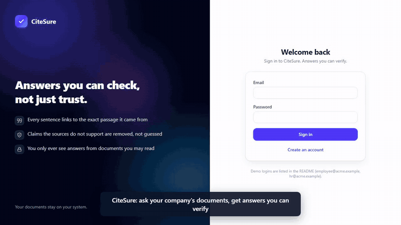
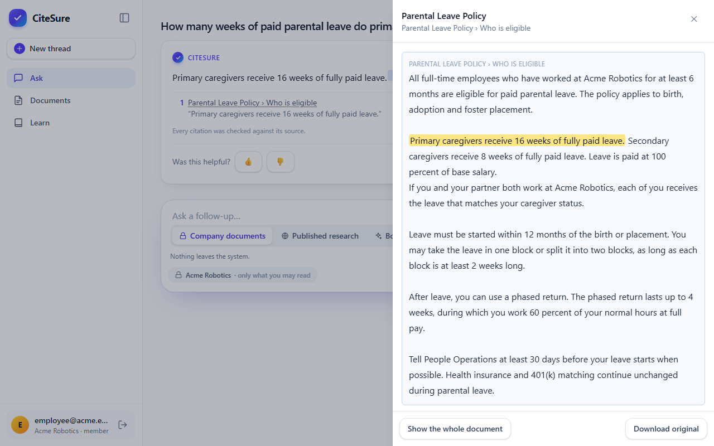
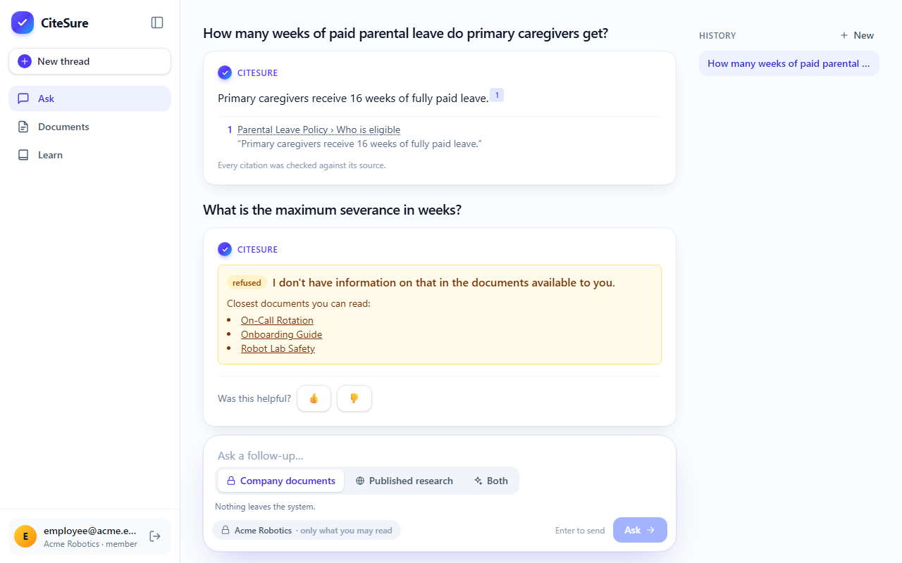
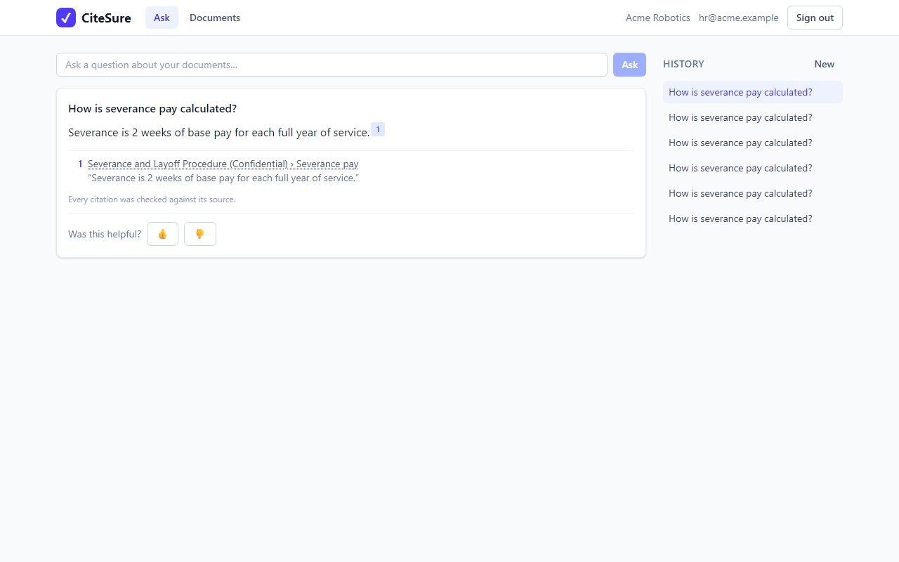

# CiteSure - answers you can verify

**Ask questions about your company's documents. Every sentence in the answer is cited, every citation is checked against its source, and nobody gets answers from documents they may not read.**

## Demo

[](docs/media/citesure-demo.mp4)

*1-minute captioned walkthrough. Click it for the full-quality MP4, or try it yourself on the live demo below.*

| | |
|---|---|
| **Demo video** (1 min, captioned) | [MP4, 1.1 MB](docs/media/citesure-demo.mp4) · recorded by Playwright, how to re-record: [docs/demo.md](docs/demo.md) |
| **Live demo** | **<https://citesure-demo.onrender.com>**: sign in as `employee@acme.example` / `citesure-demo` (free tier: the first visit after 15 idle minutes shows a "waking up" page for about a minute). How it is hosted: [docs/public-demo.md](docs/public-demo.md) |
| **How it was built** | Claude Code as a 12-agent team: [agent-team/](agent-team/README.md), log in [docs/ai-workflow.md](docs/ai-workflow.md) |
| **Beginner's guide** | 17 plain-language chapters: [substack/](substack/00-series-index.md) |

> Final project for the DataTalksClub **AI Dev Tools Zoomcamp** ([rubric](docs/course/final-project-rubric.md), [Module 5 agent pack](docs/course/module5-requirements.md)).

## The problem

Employees lose hours searching handbooks and policies. Chatbots answer confidently but cannot show *where* an answer came from, and many internal "chat with your docs" tools leak confidential files to anyone who asks. CiteSure fixes both:

1. **Every sentence has a citation**: the document, the section or page, and the exact quoted words.
2. **Every citation is verified.** The quote must exist in the passage and a second check must confirm it supports the claim. Unsupported claims are dropped; if none survive, CiteSure says *"I don't have information on that"*.
3. **Access control lives inside retrieval.** Text from collections you may not read is never fetched, so it cannot leak into an answer, a count or a timing signal.
4. **Quality is measured.** A golden set of 40 questions scores retrieval, citations and refusals; CI fails any change that answers a restricted question.

| Source with quoted words highlighted | Restricted question refused | HR sees the confidential answer |
|---|---|---|
|  |  |  |

**Also included:** a PDF viewer that opens citations on the real page · table-aware PDF parsing · watched folders that import files with the right access rules · search over published research (arXiv, Crossref, OpenAlex, Europe PMC, Semantic Scholar) · a learning layer (study sets, cited learning plans) · a hash-chained audit log and admin dashboard · optional SSO, encrypted uploads and OCR · a **private mode** where company text never leaves the machine. Details and status: [plan.md](plan.md).

## Results

40 golden questions, deterministic fake models, three identical runs ([full table and caveats](docs/eval-results.md)):

| Configuration | MRR | Citation recall | Answerable but refused | **Restricted questions refused** |
|---|---|---|---|---|
| vector only | 0.91 | 0.93 | 7% | **100%** |
| hybrid (vector + keyword) | 0.94 | 0.93 | 7% | **100%** |
| **hybrid + rerank (default)** | **0.98** | **0.97** | **3%** | **100%** |

The reranker lifted MRR from 0.91 to 0.98 and cut wrongful refusals from 7% to 3%; no configuration ever answered a restricted question. These numbers test the retrieval, citation and access-control plumbing; a real-model run needs an API key and has not been done.

## Architecture

```text
React (Vite) ──REST/SSE──▶ FastAPI ──▶ Postgres 16 + pgvector  ◀── Worker (parse → chunk → embed → index, evals)
 served by nginx            │  ACL → hybrid retrieve → rerank → generate claims → VERIFY → answer or refusal
                            └──▶ LLM (Claude | OpenAI | local Ollama | fake)   embeddings (fastembed | fake)
```

| Layer | Technology |
|---|---|
| Frontend | React 18, TypeScript, Vite, Tailwind, TanStack Query, PDF.js; client generated from `openapi.yaml` |
| Backend | Python 3.12, FastAPI, SQLAlchemy 2 (async), Alembic, PyMuPDF |
| Data | PostgreSQL 16 with pgvector and full-text search (one database for documents, vectors, ACLs, jobs, evals) |
| Ops | Docker Compose, GitHub Actions (CI, RAG-eval gate, deploy), OpenTelemetry, Prometheus, Grafana, Loki, Tempo |

More: [architecture](docs/architecture.md) · [RAG design decisions](docs/rag-design.md) · [API contract](openapi.yaml).

## Run it

Needs Docker with Compose v2.

```bash
git clone https://github.com/sharadgupta27/CiteSure.git && cd CiteSure
docker compose up -d --build                        # db, migrations, API :8000, worker, app :5173
docker compose run --rm api python -m app.seed      # demo users, 2 collections, 20 documents, 40 golden questions
```

Open <http://localhost:5173>. The password for every demo user is `citesure-demo` (local use only):

| User | Try |
|---|---|
| `employee@acme.example` | ask about parental leave (answered), then about severance (refused) |
| `hr@acme.example` | ask about severance (answered from the confidential document) |
| `admin@acme.example` | Documents, Workspace, Quality (run the evaluation), Inbox, Dashboard, Audit log |

The default uses fake models: no API key, no downloads, no cost. For real models:

```bash
LLM_PROVIDER=anthropic ANTHROPIC_API_KEY=sk-ant-... docker compose up -d     # or LLM_PROVIDER=openai OPENAI_API_KEY=sk-...
WITH_ML=true EMBEDDING_PROVIDER=fastembed RERANKER=cross-encoder docker compose up -d --build   # local embeddings + reranker
```

| Other ways to run | Guide |
|---|---|
| Private mode (local model, egress guard, allow-list proxy, no route out) | [docs/private-deployment.md](docs/private-deployment.md), [docs/public-research.md](docs/public-research.md) |
| Every compose file, port and build argument; the sample company; observability | [docs/running.md](docs/running.md) |
| Free public demo (one container: Render, Koyeb or any Docker host) | [docs/public-demo.md](docs/public-demo.md) |
| Production on one VM (EC2, Caddy, GHCR images) and free hosting options | [docs/deployment.md](docs/deployment.md), [docs/free-deployment.md](docs/free-deployment.md) |

## Test it

| What | Command | Count |
|---|---|---|
| Backend unit (fakes, fast) | `cd backend && uv sync && uv run pytest -m "not integration"` | 469 |
| Backend integration (real Postgres; ACL leak and prompt-injection tests) | `cd backend && uv run pytest -m integration` (needs Docker) | 189 |
| Lint and types | `cd backend && uv run ruff check . && uv run mypy app` | |
| Frontend | `cd frontend && npm ci && npm run test && npm run lint && npm run typecheck` | 166 |
| API contract | `npx @stoplight/spectral-cli@6 lint openapi.yaml` and `uv run pytest tests/unit/test_contract.py` | |
| End to end | stack up (with `PUBLIC_RESEARCH_ENABLED=true PUBLIC_SOURCES=sample PUBLIC_LLM_PROVIDER=fake` for the public-lane tests) and seeded, then `cd e2e && npm ci && npx playwright install chromium && npx playwright test` | 12 |
| Agent pack | `uv run --no-project --with pytest python -m pytest agent-hooks/tests`, `cd mcp-server && uv run pytest` | 60 + 13 |
| Evaluation | `cd backend && uv run python -m app.evals.run --matrix evals/experiments.yaml` | 40 questions |

Tests never call a real model. The ACL leak tests cover every endpoint that returns content.

## Built with AI agents

| Piece | Where |
|---|---|
| The team that built it (tech lead + 11 specialists, by phase) | [agent-team/](agent-team/README.md) |
| How the work was planned, delegated and verified | [docs/ai-workflow.md](docs/ai-workflow.md), [CLAUDE.md](CLAUDE.md), [AGENTS.md](AGENTS.md) |
| Agent extension pack: 4 skills, 3 read-only subagents, MCP server (scoped service user), guardrail hooks, plugin, nightly agent | [docs/agent-extension-pack.md](docs/agent-extension-pack.md), [docs/permissions.md](docs/permissions.md) |

## Security

The ACL is enforced in the retrieval SQL; document text is treated as untrusted (delimited, never obeyed, no tools for the model); uploads are checked by magic bytes; rate limits, strict CORS and CSP; deleting a document also scrubs its quotes from stored answers; agents cannot loosen their own guardrails. Threat model, AI data policy and real scanner output: [security/](security/). Known gaps are listed there and in [plan.md](plan.md#6-known-gaps).

## Status

Verified: all test suites above, the development stack, the private stack end to end with a local model, and the public demo at <https://citesure-demo.onrender.com> (fake models). **Not done:** a real-model evaluation, a real Keycloak/Entra login, real OCR, and the AWS production deployment (pipeline and runbook are written). Full status: [plan.md](plan.md).

## License

MIT. **Exception:** PyMuPDF (PDF reading) is AGPL-3.0: fine for internal use; if you offer CiteSure as a service to others, publish your source or swap the library (used only in `backend/app/rag/parsing/pdf.py` and `backend/app/research/fulltext.py`). The demo documents are fictional.
