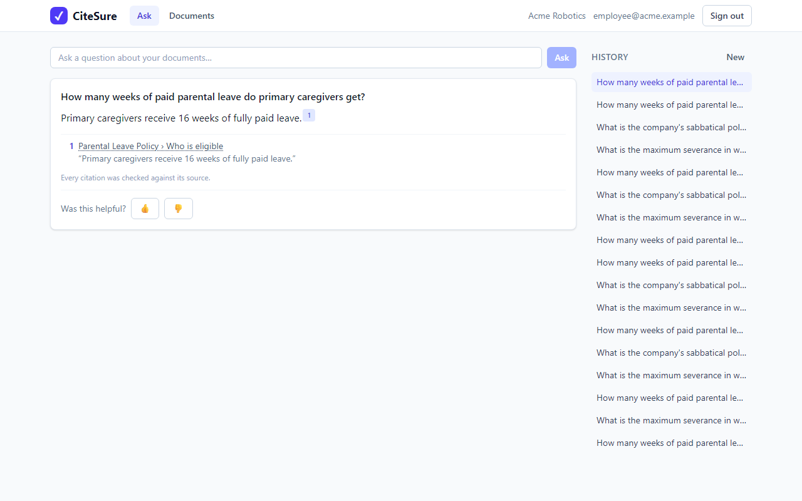
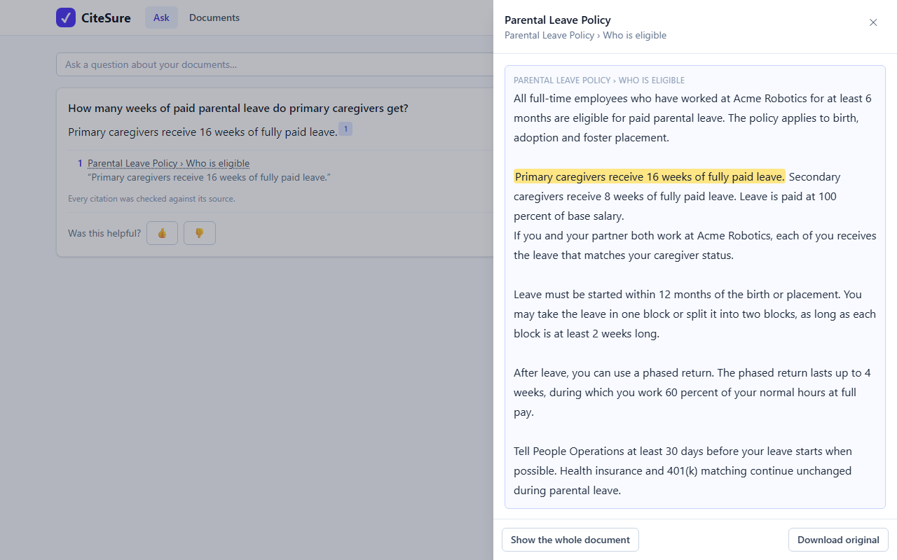
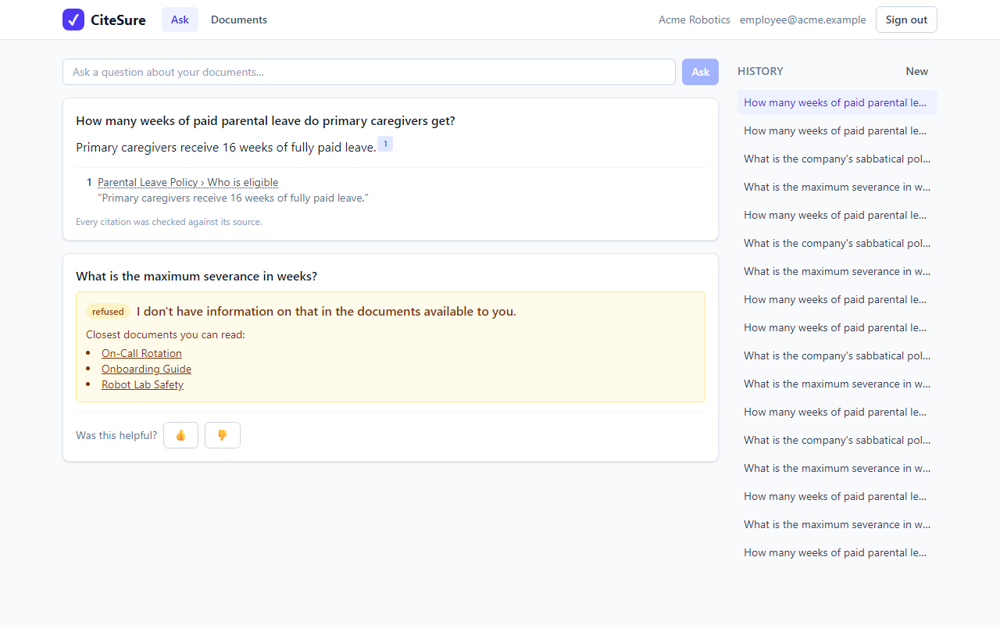
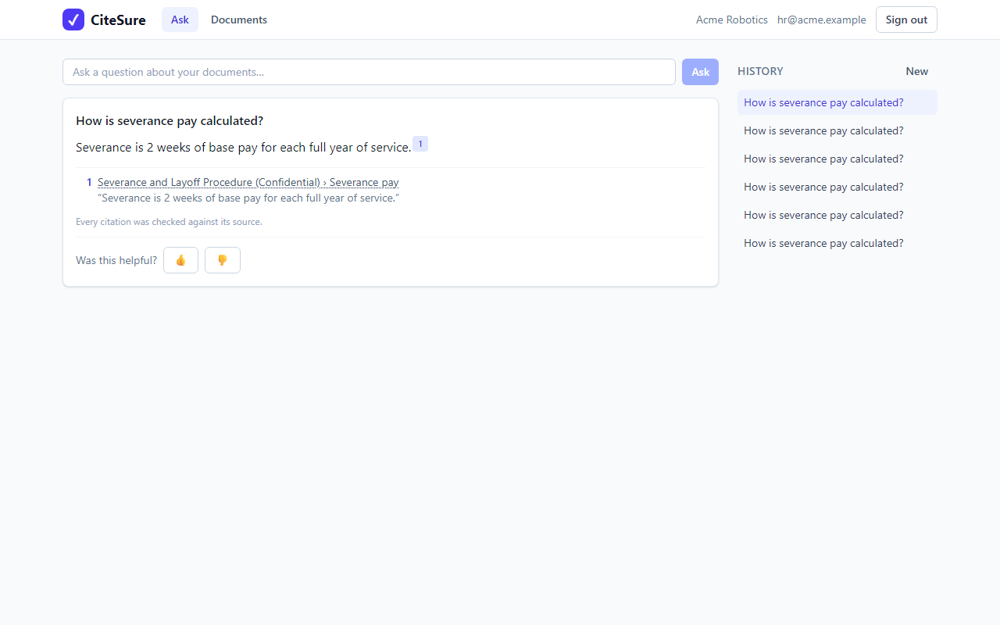
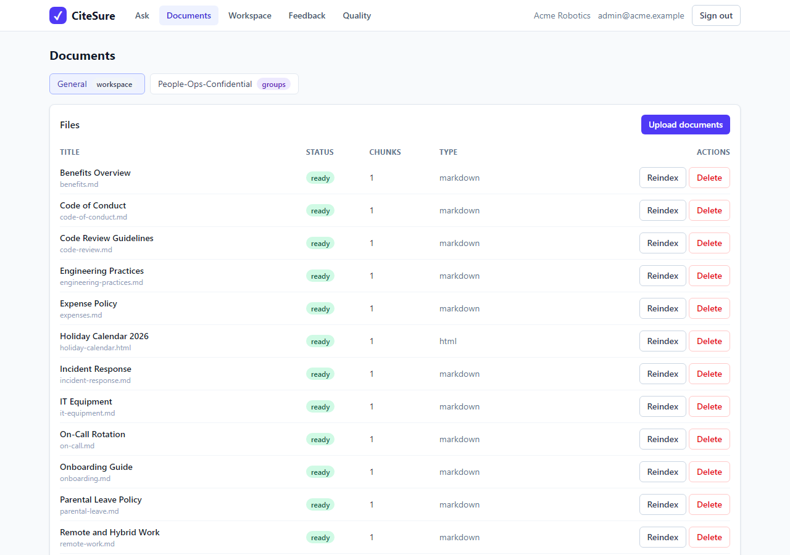
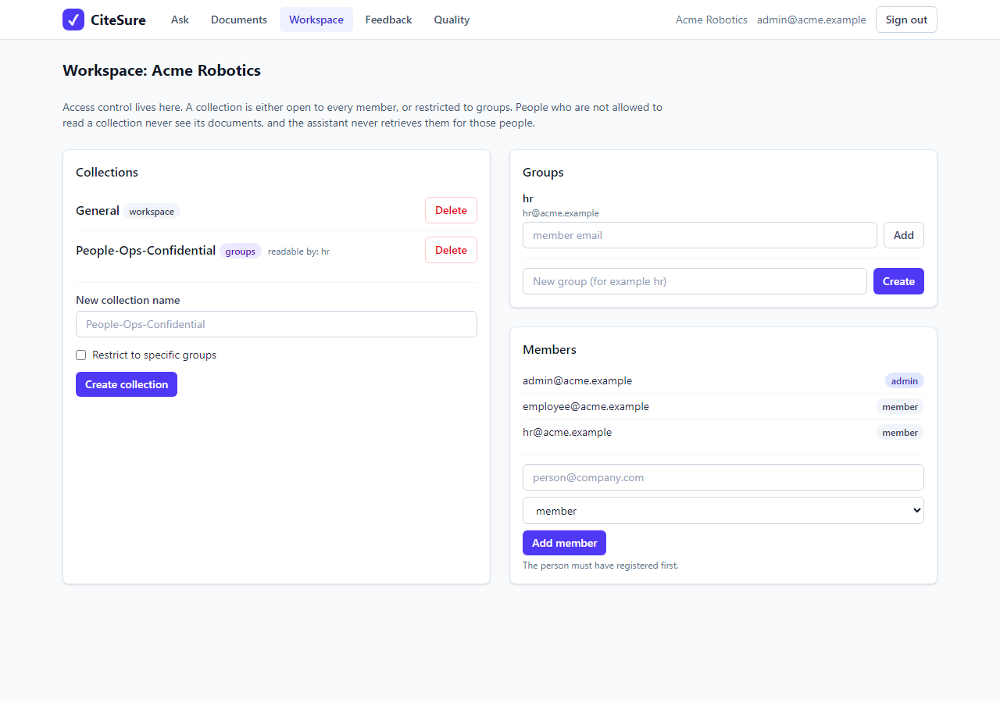
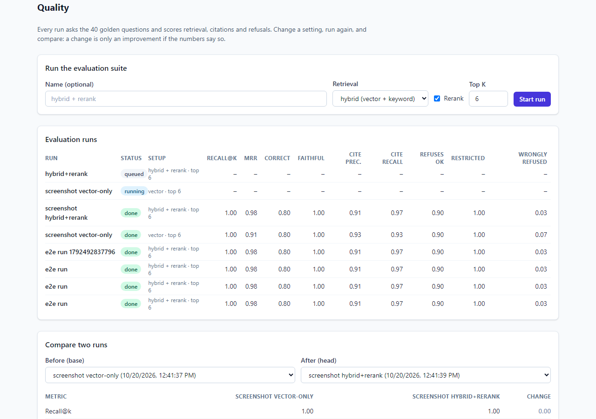

# CiteSure — answers you can verify

**Grounded document Q&A with checked citations and permission-aware retrieval.** Ask a question about your company's documents. Every sentence in the answer carries a citation, every citation was checked against its source before you see it, and people can only ever get answers from documents they are allowed to read.



> Final project for the DataTalksClub **AI Dev Tools Zoomcamp** (rubric: [docs/course/final-project-rubric.md](docs/course/final-project-rubric.md), agent pack: [docs/course/module5-requirements.md](docs/course/module5-requirements.md)). Built with a coding agent; how is documented in [docs/ai-workflow.md](docs/ai-workflow.md).
> A step-by-step guide to building it, in plain language, is in [substack/](substack/00-series-index.md).

## 1. The problem

Employees lose hours searching handbooks, policies and manuals. Generic chatbots answer confidently but cannot show *where* an answer came from, so nobody trusts them for HR, compliance or security questions. Many internal "chat with your docs" systems also **leak documents across permission boundaries**: a bot that can read the confidential folder will happily summarise it for anyone.

CiteSure fixes both:

1. **Every sentence has a citation** (document, section/page and the exact quoted words).
2. **Every citation is verified.** The quote must really exist in the cited passage, and a second check must confirm the passage supports the claim. Claims that fail are dropped; if nothing survives, CiteSure says *"I don't have information on that"* and points to the closest documents you may read.
3. **Access control lives inside retrieval.** Chunks from collections you may not read are never fetched, so they cannot leak into an answer, a count or a timing signal.
4. **You can measure it.** A quality dashboard scores retrieval, citations and refusals on a golden question set, and a CI gate fails any change that answers a restricted question.

### Expected behaviour (the happy path, all covered by E2E tests)

1. An admin creates a workspace with two collections: `General` (everyone) and `People-Ops-Confidential` (HR group only), and uploads documents (PDF, DOCX, Markdown, HTML). Ingestion runs in the background; each document shows `queued → parsing → embedding → ready`.
2. An employee asks *"How many weeks of paid parental leave do primary caregivers get?"* and gets *"Primary caregivers receive 16 weeks of fully paid leave."* with a numbered citation. Clicking it opens the source with the quoted words highlighted.
3. The same employee asks *"What is the maximum severance in weeks?"*, which exists only in the confidential collection, and gets *"I don't have information on that"*. An HR member asks the same question and gets the answer, cited to the confidential document.
4. A thumbs-down with a comment lands in the admin's feedback queue; the admin promotes it to the golden set. The **Quality** page runs the evaluation and compares configurations (for example vector-only versus hybrid + rerank).

| Source viewer (quoted words highlighted) | Restricted question refused | HR sees the confidential answer |
|---|---|---|
|  |  |  |

| Documents and ingestion status | Access control | Quality dashboard |
|---|---|---|
|  |  |  |

## 2. Results (measured)

Deterministic fake providers, 40 golden questions, three identical runs. Full table, caveats and known failures: [docs/eval-results.md](docs/eval-results.md).

| config | recall@6 | MRR | cite-precision | cite-recall | wrongly refused | **restricted questions refused** |
|---|---|---|---|---|---|---|
| vector only | 1.00 | 0.91 | 0.93 | 0.93 | 7% | **100%** |
| hybrid (vector + keyword) | 1.00 | 0.94 | 0.93 | 0.93 | 7% | **100%** |
| **hybrid + rerank (default)** | 1.00 | **0.98** | 0.91 | 0.97 | **3%** | **100%** |

> Adding the reranker raised MRR from **0.91 to 0.98** and cut wrongful refusals from **7% to 3%**; no configuration ever answered a restricted question. These numbers measure the retrieval, citation and access-control plumbing with fake models; the real-model run is a nightly job (needs an API key) and is **not** included here.

## 3. Architecture and technologies

```text
React (Vite) ──REST/SSE──▶ FastAPI ──▶ Postgres 16 + pgvector     ◀── Worker (parse → chunk → embed → index; eval runs)
 served by nginx            │  ACL → hybrid retrieve → rerank → generate claims → VERIFY → answer | refusal
                            └──▶ LLM provider (Anthropic | fake)   embeddings (fastembed | fake)   blobs (local | S3)
```

| Part | Technology | Role |
|---|---|---|
| Frontend | React 18, TypeScript, Vite, Tailwind, TanStack Query | Ask, Documents, Workspace admin, Feedback queue, Quality dashboard, source viewer. One typed API client generated from `openapi.yaml`. |
| Contract | OpenAPI 3.1 (`openapi.yaml`) + Spectral | Source of truth; a drift test fails if the backend disagrees. |
| Backend | Python 3.12, FastAPI, SQLAlchemy 2 (async), Alembic | Layered `api → services → repositories`. |
| Database | PostgreSQL 16 + pgvector + full-text search | One database for documents, vectors, ACLs, jobs, answers and evaluation. |
| Containers | Docker, Compose | `docker compose up` runs db, migrations, api, worker and frontend. |
| CI/CD | GitHub Actions | Lint, types, unit, integration, E2E, security scans, image build; RAG-eval gate; deploy to EC2 after green CI. |
| Observability | OpenTelemetry, Prometheus, Grafana, Loki, Tempo | Per-stage latency, refusal/verification rates, cost, alerts. |

More detail and the request flows: [docs/architecture.md](docs/architecture.md). Every RAG design decision and the experiment behind it: [docs/rag-design.md](docs/rag-design.md).

## 4. Run it (reproducible, verified)

Requirements: Docker with Compose v2. (For development also: Python 3.12 + [uv](https://docs.astral.sh/uv/), Node 22.)

```bash
git clone <this repo> && cd CiteSure
docker compose up -d --build                           # db + migrations + api :8000 + worker + frontend :5173
docker compose run --rm api python -m app.seed         # demo users, 2 collections, 20 documents, 40 golden questions
```

Open <http://localhost:5173> and sign in (password for all demo users: `citesure-demo`, local development only):

| User | Role | Try |
|---|---|---|
| `employee@acme.example` | member | ask about parental leave; ask about severance (refused) |
| `hr@acme.example` | member + `hr` group | ask about severance (answered, cited to the confidential document) |
| `admin@acme.example` | workspace admin | Documents, Workspace, Feedback queue, **Quality** (run the evaluation) |

The default setup uses deterministic **fake providers** (no API key, no downloads, no cost). To use real models:

```bash
# real answers with Claude (needs a key)
LLM_PROVIDER=anthropic ANTHROPIC_API_KEY=sk-ant-... docker compose up -d
# real local embeddings + cross-encoder reranker (baked into the image; larger build)
WITH_ML=true EMBEDDING_PROVIDER=fastembed RERANKER=cross-encoder docker compose up -d --build
# (changing the embedding provider needs a reindex: POST /documents/{id}/reindex)
```

Variables are documented in [.env.example](.env.example). Stop everything: `docker compose down` (add `-v` to delete the data).

## 5. Test it

| What | Command | Needs | Count |
|---|---|---|---|
| Backend unit (fakes, fast) | `cd backend && uv sync && uv run pytest -m "not integration"` | nothing | 94 |
| Backend integration (real Postgres + pgvector, ACL leak tests, injection tests, worker, eval) | `cd backend && uv run pytest -m integration` | Docker | 73 |
| Lint and types | `cd backend && uv run ruff check . && uv run ruff format --check . && uv run mypy app` | | |
| Frontend (logic, components, pages) | `cd frontend && npm ci && npm run test && npm run lint && npm run typecheck` | | 59 |
| API contract | `npx @stoplight/spectral-cli@6 lint openapi.yaml` and `uv run pytest tests/unit/test_contract.py` | | |
| End to end (browser, against Compose) | `docker compose up -d --build && docker compose run --rm api python -m app.seed && cd e2e && npm ci && npx playwright install chromium && npx playwright test` | Docker | 9 |
| Agent pack | `uv run --no-project --with pytest python -m pytest agent-hooks/tests`; `cd mcp-server && uv run pytest`; `cd custom-agent && uv run --no-project --with pytest --with httpx python -m pytest` | | 60 + 12 + 13 |
| Evaluation (quality) | `cd backend && uv run python -m app.evals.run --matrix evals/experiments.yaml` | Postgres | 40 questions |

Integration tests are clearly separated (`@pytest.mark.integration`, folder `tests/integration/`) and never call a real LLM or embedding API. The **ACL leak tests** cover every endpoint that returns content: documents, chunks, files, ask, streaming, retrieval diagnostics, and stored answers after access is revoked.

## 6. The agent extension pack (Module 5)

Everything a coding agent needs to work on CiteSure safely: [docs/agent-extension-pack.md](docs/agent-extension-pack.md) · [permissions](docs/permissions.md) · [demo script](docs/demo.md).

| Piece | Where |
|---|---|
| Project instructions | [AGENTS.md](AGENTS.md), [CLAUDE.md](CLAUDE.md) |
| 4 reusable workflows (skills) | [agent-capabilities/](agent-capabilities/): `add-golden-question`, `ingest-new-doc-type`, `tune-retrieval`, `review-api-change` |
| 3 specialist subagents (read-only) | `retrieval-debugger`, `citation-auditor`, `api-contract-reviewer` |
| MCP server (6 tools, scoped service user) | [mcp-server/](mcp-server/) |
| Guardrail hooks (secrets, golden-set, migrations, destructive commands; format; stop checks) | [agent-hooks/](agent-hooks/) |
| Plugin and nightly custom agent | [plugins/citesure-agent-pack/](plugins/citesure-agent-pack/), [custom-agent/](custom-agent/) |

## 7. Security

Threat model, AI/data policy and real scanner output (gitleaks, Semgrep, Trivy, pip-audit, npm audit) are in [security/](security/). Highlights: ACL enforced inside retrieval SQL; document text treated as untrusted (delimited, never obeyed, no tools for the model); magic-byte upload validation; rate limits; strict CORS and CSP; deleting a document also scrubs its quotes from stored answers; an agent cannot loosen its own guardrails.
Known gaps are listed honestly in the threat model (JWT in `localStorage`, in-memory rate limits, no malware scanning, admins read everything).

## 8. Deployment

Target: one AWS EC2 `t3.medium` running [docker-compose.prod.yml](docker-compose.prod.yml) behind Caddy (automatic HTTPS), images from GHCR, built and rolled out by [.github/workflows/deploy.yml](.github/workflows/deploy.yml) after CI is green. Step-by-step: [docs/deployment.md](docs/deployment.md).

> **Status:** the pipeline, compose file and runbook are written and the production images build, but **no public instance was deployed from this repository** (it needs an AWS account, a domain and GitHub secrets that are not part of this codebase). Rubric item "deployed with a working URL" is therefore not claimed.

## 9. Repository map

```text
README.md  product-spec.md  AGENTS.md  CLAUDE.md  plan.md  openapi.yaml  docker-compose.yml  docker-compose.prod.yml
frontend/  backend/  e2e/  corpus/  docs/  security/  ops/  deploy/  .github/workflows/
agent-capabilities/  agent-hooks/  mcp-server/  plugins/  custom-agent/  substack/
```

## 10. Rubric coverage

| # | Criterion | Where |
|---|---|---|
| 1 | Problem description | §1, [product-spec.md](product-spec.md) |
| 2 | AI-assisted workflow | [docs/ai-workflow.md](docs/ai-workflow.md), [AGENTS.md](AGENTS.md), [CLAUDE.md](CLAUDE.md) |
| 3 | Technologies and architecture | §3, [docs/architecture.md](docs/architecture.md), [docs/rag-design.md](docs/rag-design.md) |
| 4 | Frontend (structure, centralised API, tests) | `frontend/src/api/` (single client), 59 Vitest tests, §5 |
| 5 | API contract | [openapi.yaml](openapi.yaml), generated client, drift test |
| 6 | Backend (structure, contract, tests) | `backend/app/`, 167 pytest tests |
| 7 | Database (environments, docs) | PostgreSQL + pgvector, Alembic, [architecture.md § environments](docs/architecture.md#environments-and-the-database-config-rubric-7) |
| 8 | Containerisation | [docker-compose.yml](docker-compose.yml), multi-stage Dockerfiles, §4 |
| 9 | Integration tests | `backend/tests/integration/`, `e2e/` |
| 10 | Deployment | pipeline and runbook ready; **not deployed here** (§8) |
| 11 | CI/CD | [.github/workflows/](.github/workflows/) (CI, RAG-eval gate, deploy) |
| 12 | Agent extension pack | §6 |
| 13 | Security, audit, DevOps | [security/](security/), [ops/](ops/) |
| 14 | Reproducibility | §4 and §5 |

## 11. License

MIT (code). The demo corpus is a fictional handbook written for this project. The optional GitLab Handbook download (`corpus/fetch_gitlab_handbook.py`) is CC BY-SA 4.0 and is never committed.
