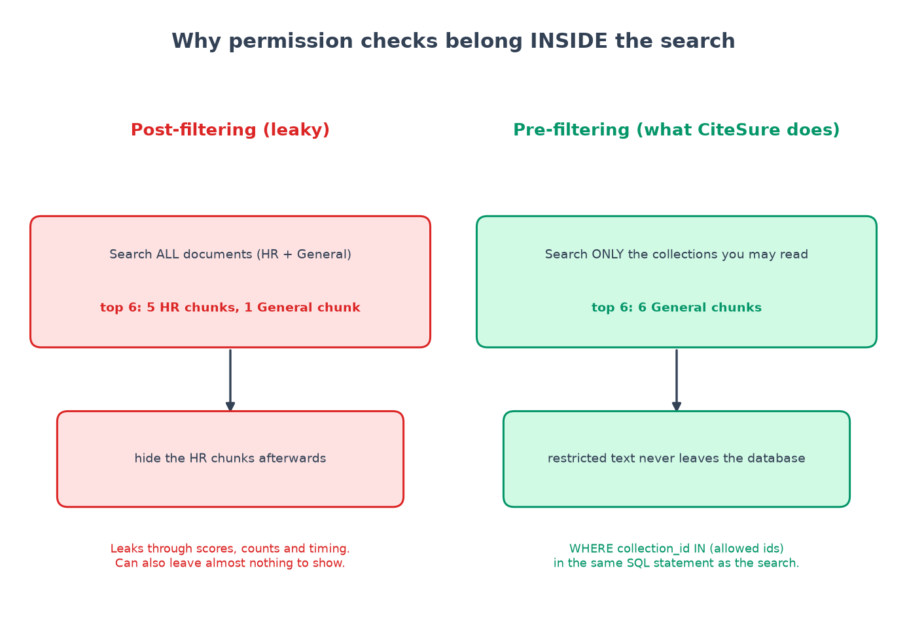
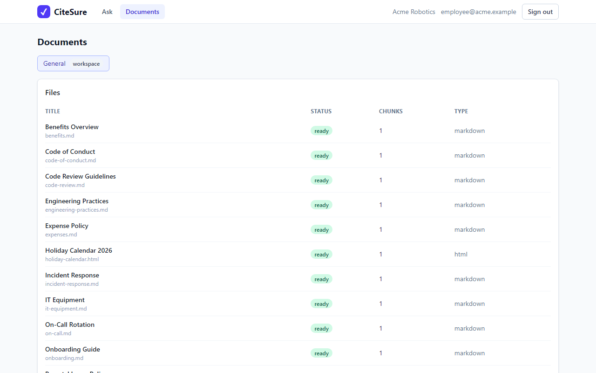

# Chapter 3: Permission-aware RAG

*Check permissions inside the search, never after it.*

**You will learn:** why many "chat with your documents" systems leak, how to design access control so it cannot, and how to test it properly.
**You will build:** users, workspaces, groups and collections; one function that decides who may read what; and 17 leak tests.
**Time:** about 2 hours. **Code:** `backend/app/services/acl.py`, `backend/app/repositories/documents.py`, `backend/tests/unit/test_acl.py`, `backend/tests/integration/test_acl_leaks.py`.

---

## The leak nobody notices

Picture the setup. The company has two folders of documents:

- **General**: everyone can read it.
- **People-Ops-Confidential**: only the HR group can read it.

A chatbot searches *all* the documents, picks the best six passages, and then... "hides" the ones the user may not see. It sounds fine. It is not. Here is why:



1. **It can starve the answer.** If the five best matches are HR documents, hiding them leaves one weak match. The user gets a bad answer, and the bot may even say "I found nothing", which *tells* them something relevant exists.
2. **It leaks through side channels.** The *scores*, the *number* of matches or the *time* the search took can all reveal that restricted content matched.
3. **It is one forgotten `if` away from disaster.** Every new feature that touches documents has to remember to filter afterwards. Someone will forget.

The fix is simple to say: **do not search what the user may not read.** Put the permission check *inside* the database query, so restricted rows are never fetched at all:

```sql
SELECT ... FROM chunks
WHERE collection_id IN (:allowed_ids)      -- the permission filter
ORDER BY embedding <=> :query_vector       -- the search
LIMIT 30
```

Restricted text never leaves the database. There is nothing to hide afterwards.

## The rules

Keep the permission model small, so you can reason about it:

| Who | May read |
|---|---|
| **Admin** of a workspace | every collection in that workspace |
| **Member** | collections marked "workspace" (open to everyone), plus collections restricted to a **group** they belong to |
| **Anyone else** | nothing, and the workspace looks like it does not exist |

(That "admins read everything" choice is a decision, not an accident. It is written down in `docs/permissions.md` and flagged in the threat model, because it makes admin passwords more sensitive.)

## Step 1: one function that decides everything

All of this lives in one place, `backend/app/services/acl.py`. The decision itself is a *pure function*: no database, no web framework, just rules in and a list out. That makes it easy to test exhaustively.

```python
def resolve_allowed(memberships, user_group_ids, rows):
    """memberships maps workspace id -> role."""
    allowed = []
    for row in rows:
        role = memberships.get(row.workspace_id)
        if role is None:
            continue                      # not a member: sees nothing
        if role == "admin" or row.visibility == "workspace" or (row.group_ids & user_group_ids):
            allowed.append(row.collection_id)
    return allowed
```

A second function, `allowed_collection_ids(session, user_id)`, loads the needed rows from the database and calls it.

**Rule of the whole codebase:** this is the *only* place that decides who may read what. Every other part of the code asks it.

## Step 2: make it hard to forget

Good design makes the right thing the *easy* thing. The repository functions that read documents or chunks **require** the allowed ids as an argument. There is no way to call them without one:

```python
async def get_chunk(session, chunk_id, *, allowed_collection_ids):
    stmt = (
        select(Chunk, Document.title)
        .join(Document, Document.id == Chunk.document_id)
        .where(Chunk.id == chunk_id, Chunk.collection_id.in_(allowed_collection_ids))
    )
```

A developer (or an AI assistant) who writes a new query has to pass the argument, or the code will not even call. The functions that bypass it are deliberately ugly and named `..._for_worker`, so they stand out in a code review.

One more trick: each chunk row stores its **collection id directly** (a copy, "denormalised"). That lets the permission filter and the vector search happen in *one* SQL statement without a slow join.

## Step 3: say "not found", not "forbidden"

If a normal employee asks for the confidential salary document by its id, the API answers **404 Not Found**, the same as for an id that does not exist. A `403 Forbidden` would confirm the document is real. Same for whole workspaces: someone who is not a member gets 404, not 403.

## Step 4: test it like an attacker

Access control is the part you test hardest. CiteSure has two kinds of test:

**A truth table** (`tests/unit/test_acl.py`): every combination of role (admin/member), group membership, and collection type, checked against the rules. It runs in milliseconds.

**Leak tests** (`tests/integration/test_acl_leaks.py`): they run against a real Postgres database with a seeded company. The pattern is: log in as the employee, try to reach every restricted thing, expect 404. For example:

```python
async def test_employee_cannot_read_restricted_documents_chunks_or_files(client, world):
    doc_ids, chunk_ids = await confidential_ids(client, world)   # fetched as the admin
    for doc_id in doc_ids:
        for suffix in ("", "/file", "/chunks"):
            response = await client.get(f"{API}/documents/{doc_id}{suffix}", headers=world.employee)
            assert response.status_code == 404, f"GET /documents/{{id}}{suffix} leaked to a plain member"
    for chunk_id in chunk_ids:
        assert (await client.get(f"{API}/chunks/{chunk_id}", headers=world.employee)).status_code == 404
```

The suite covers every endpoint that returns content: documents, chunks, the original file, asking a question (normal and streaming), the retrieval diagnostics endpoint, and people from outside the workspace entirely. It also asserts that the restricted *text itself* (for example "150,000" or "26 weeks") never appears in any answer an employee receives, not even in the "closest documents" list of a refusal.

### The case people forget: access that changes later

Suppose HR asks a question and gets an answer that quotes a confidential document. Later an admin removes that group's access. The *stored* answer still contains the quote! So when anyone reads a stored answer or thread, the server **re-checks** each citation against the reader's *current* permissions and removes the ones they can no longer read:

```python
async def test_revoking_access_removes_confidential_citations_from_stored_answers(client, app):
    ...
    # The admin moves the collection to another group: hr loses access.
    patch = await client.patch(f"{API}/collections/{secret['id']}", json={"group_ids": [other["id"]]}, headers=admin)
    stored = (await client.get(f"{API}/answers/{before['id']}", headers=hr)).json()
    assert stored["status"] == "refused" and stored["claims"] == []
    assert "Bluebird" not in all_text(stored)
```

There is one more, quieter, hole: when creating a collection restricted to groups, the server checks the groups belong to *that same workspace*. Without it, someone could name a group from another company's workspace and open a door across tenants. There is a test for that too.

## The seeded demo, so you can try it

`docker compose run --rm api python -m app.seed` creates three people (password `citesure-demo`, for local use only):

| User | Can see |
|---|---|
| `employee@acme.example` | General only |
| `hr@acme.example` | General + People-Ops-Confidential |
| `admin@acme.example` | everything, and can manage |

Log in as the employee and ask "What is the maximum severance in weeks?". You get *"I don't have information on that in the documents available to you."* Log in as HR and ask the same: you get the answer, cited to the confidential file.


The same question as HR gets a cited answer from the confidential file, while the employee's document list does not even show it:




## What went wrong (and what it taught me)

- **The admin question.** The first draft let admins read everything and I did not think about what that meant for the AI coding agent in chapter 12. If you ever give an agent an *admin* account, the access rules stop protecting confidential collections from it. So the agent gets a **plain member** account, and the endpoint it needs for debugging (`/retrieval/explain`) was changed to work for members, showing each caller only what their own permissions allow. I made that change *because of* the agent design, and wrote a stronger leak test for it. Security decisions in one chapter ripple into others.
- **Tests find fail-open code.** A later chapter shows a guardrail that looked right and failed open. Access control code deserves the same suspicion: every rule is guilty until a test proves it.

## Recap

- Check permissions **inside the query** (pre-filter), not afterwards.
- Keep the decision in **one small pure function** and make every reader of documents **require** its output.
- Answer **404**, not 403.
- Test with a **truth table** and **leak tests against a real database**, including stored answers after access changes.

## Try it yourself

1. In `test_acl.py`, add a third group `legal` and a collection restricted to it. Predict which rows of the truth table change, then run the tests.
2. Temporarily remove the `allowed_collection_ids` filter from `fts_search` in `backend/app/rag/retrieval/fts.py`. Which leak test fails first? (Put the line back.)
3. Why does a refusal include a list of "closest documents"? Could that list ever leak? (Look at how it is built, and at the assertion in `test_restricted_questions_are_refused_for_employees_and_never_leak`.)

**Next:** [Chapter 4: chunking is a product decision →](04-chunking-is-a-product-decision.md)
