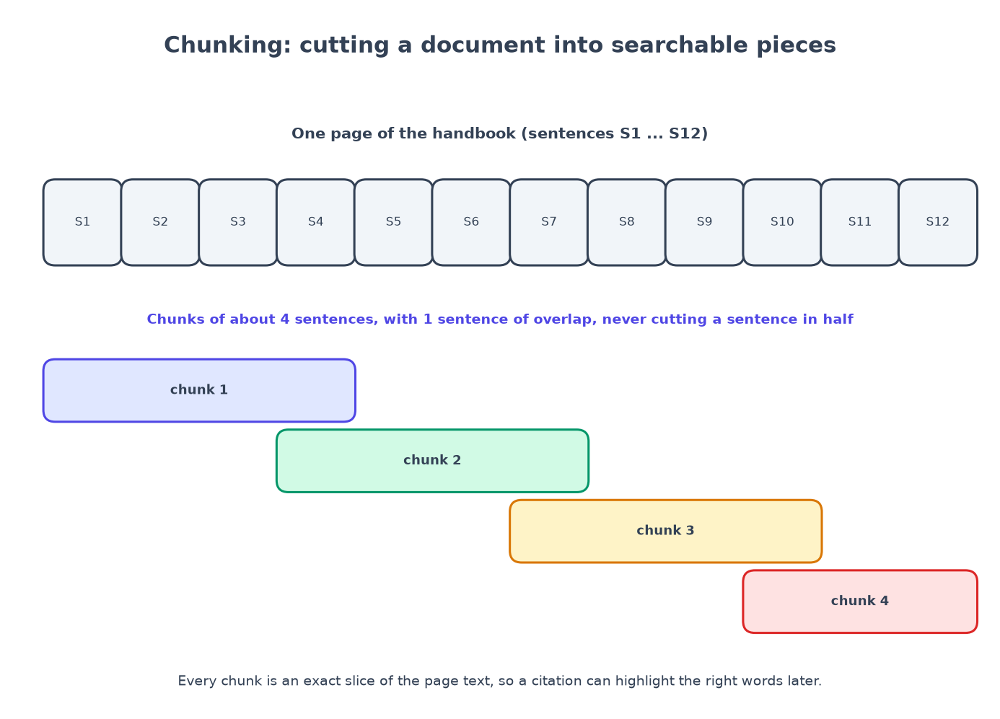

# Chapter 4: Chunking is a product decision

*How you cut a document decides what you can find, and what you can prove.*

**You will learn:** how an uploaded file becomes searchable pieces, why "chunking" is more than a technical detail, and how a Postgres table can run your background jobs.
**You will build:** safe uploads, four parsers (PDF, DOCX, Markdown, HTML), a chunker whose pieces are exact slices of the document, a PII scanner, an embedder, and a job queue.
**Time:** about 3 hours. **Code:** `backend/app/rag/parsing/`, `backend/app/rag/chunking/chunker.py`, `backend/app/services/ingest.py`, `backend/app/repositories/jobs.py`.

---

## Why we cut documents at all

An AI model can only read so much at once, and searching a whole 40-page handbook for one sentence is wasteful. So before we can search, we cut every document into **chunks**: small passages, each searched and cited on its own.

Cutting sounds trivial. It is not, and the cut is a *product decision*:

- Cut **too small** and a fact gets separated from the words that qualify it ("employees get 25 days" in one chunk, "after their first year" in the next).
- Cut **too big** and the chunk is full of unrelated text, so it matches too many questions and the highlight in the citation is vague.
- Cut **in the middle of a sentence** and neither half makes sense.



For CiteSure there is one extra requirement, and it shapes everything: **a citation must be able to highlight the exact words.** So every chunk must remember *exactly where it came from* in the original document.

## Step 1: accept uploads safely

Uploads are the biggest door into your system, so the rules are strict:

- **Never trust the filename or the "content type" the browser claims.** Anyone can rename `virus.exe` to `report.pdf`. We look at the first bytes of the file (the "magic bytes"): a PDF starts with `%PDF-`, a DOCX is a ZIP archive containing `word/document.xml`.
- **A zip can be a bomb**: a tiny file that expands to gigabytes. We refuse archives that expand beyond 200 MB or contain over 2,000 entries, *before* any parser touches them.
- **Limit the size** before reading the whole body into memory (the route reads at most the limit plus one byte).
- **Reject duplicates** by comparing a SHA-256 fingerprint of the file.
- **Never use the uploaded filename as a path.** We generate our own storage key, and sanitise the displayed name (`../../etc/passwd.md` becomes harmless).

```python
def detect(data: bytes) -> Detected:
    if data.startswith(b"%PDF-"):
        return Detected("pdf", MIME["pdf"])
    if data.startswith(b"PK\x03\x04"):
        _check_docx(data)               # must contain word/document.xml, and not be a bomb
        return Detected("docx", MIME["docx"])
    if b"\x00" in data[:4096]:
        raise UnsupportedMedia("Binary files other than PDF and DOCX are not supported")
    ...
```

The upload endpoint does **no parsing**. It checks, stores the file, writes a row marked `queued`, adds a job, and replies "202 Accepted". A 200-page PDF must never block a web request.

## Step 2: one parser per file type, one common shape

Each parser turns its file into the same simple structure:

```python
@dataclass(frozen=True)
class Section:
    heading_path: tuple[str, ...]   # ("Parental Leave Policy", "How much leave you get")
    text: str
    page: int | None = None         # set for PDFs
```

| Type | How | Details worth knowing |
|---|---|---|
| Markdown | `markdown-it-py` | headings define the path; list items and table rows become their own lines |
| HTML | `beautifulsoup4` | scripts, styles, navigation and footers removed; only "leaf" blocks are read so a list inside a list is not counted twice |
| DOCX | `python-docx` | heading styles become the path; tables are read in order; merged cells (which repeat their text) are de-duplicated |
| PDF | PyMuPDF (chapter 16; this chapter's first version used `pypdf`) | sections follow headings, each with its page number; tables with three or more columns are rebuilt; hyphenated line breaks are repaired; a scanned PDF with no text fails with a *clear message* (no OCR in the MVP) |

Because everything becomes `Section`s, the chunker, the search and the citation viewer need no special cases for any file type. Adding a new type later (a PPTX, say) means writing *one* new parser. That is exactly what the `ingest-new-doc-type` skill in chapter 12 walks an agent through.

A related decision: Markdown parsing **drops raw HTML tags**. That removes a whole class of tricks (a forged `<system>` tag hidden in a document never even reaches the chunker), but it also means the text of such a tag is lost. Chapter 6 shows a second defence for the cases where the text survives.

## Step 3: the chunker

The rules, in plain language:

1. Split the document into **sentences**.
2. Pack sentences into a chunk until it holds about **400 tokens** (word-and-punctuation pieces).
3. Start the next chunk with the last sentence or two of the previous one (about **15% overlap**), so a fact on a border is not lost.
4. Prefer to start a new chunk at a **section boundary** once the current one is more than 60% full.
5. **Never cut a sentence.** (The only exception: a "sentence" over 800 tokens, such as a giant table row, is cut at word boundaries.)
6. Every chunk is an **exact slice** of the document's text, so it carries `char_start` and `char_end`.

The core loop is short:

```python
while s < n:
    e = s; used = 0
    while e < n:
        unit = units[e]
        if e > s:
            if used + unit.tokens > target_tokens: break
            if e > main_start and unit.starts_section and used >= SECTION_BREAK_FILL * target_tokens: break
        used += unit.tokens; e += 1
    window = units[s:e]
    char_start, char_end = window[0].start, window[-1].end
    text = document_text[char_start:char_end]            # an exact slice
    ...
    # overlap: step back over a few sentences for the next chunk
```

### The test that matters most

Because the citation highlight depends on offsets, the very first chunker test is:

```python
@pytest.mark.parametrize("target", [30, 60, 120, 400])
def test_every_chunk_is_an_exact_slice_of_the_document(target):
    document_text, chunks = chunk_sections(make_sections(), target_tokens=target, overlap=0.15)
    for chunk in chunks:
        assert document_text[chunk.char_start : chunk.char_end] == chunk.text
```

Others check that no sentence is cut, that consecutive chunks leave no gap (only whitespace may lie between them), that overlaps really repeat text, and that PDF page numbers are tracked.

## Step 4: embeddings, the "meaning" of a passage

To search by *meaning*, each chunk is turned into a list of numbers called an **embedding** (here 384 of them), so that passages with similar meaning get similar numbers. A question is embedded the same way, and the closest passages win.

- **Default for real use:** a small local model (`BAAI/bge-small-en-v1.5` through `fastembed`). It runs on your own machine: free, and no document text leaves it.
- **Default for development and tests:** a **fake embedder** I wrote, a "feature hashing" trick: each word is hashed into one of 384 buckets with a plus or minus sign, counts are dampened, and the vector is normalised. It has *no idea* that "vacation" and "PTO" are related, but passages sharing words get similar numbers, it is deterministic, and it costs nothing. That determinism is what makes the evaluation in chapter 7 repeatable.

Each chunk is embedded together with its **title and headings** (`"Parental Leave Policy > How much leave you get\n..."`), because "How much leave you get" tells the model a lot that the chunk's body does not repeat.

## Step 5: a job queue made of a table

The worker needs to pick up "ingest this document" jobs. Instead of adding a new system (Redis, RabbitMQ...), we use a table in the database we already have. The key is one SQL feature, `FOR UPDATE SKIP LOCKED`:

```sql
UPDATE jobs SET status = 'running', locked_at = now(), attempts = attempts + 1
WHERE id = (
    SELECT id FROM jobs
    WHERE (status = 'queued' AND run_after <= now())
       OR (status = 'running' AND locked_at < now() - interval '15 minutes')
    ORDER BY run_after
    FOR UPDATE SKIP LOCKED
    LIMIT 1
)
RETURNING id, kind, payload, attempts, max_attempts
```

In words: *find one waiting job, lock it so nobody else can take it, and if another worker already locked a row, skip to the next.* Many workers can pull jobs at once and never get the same one. A job that was "running" for over 15 minutes (its worker crashed) is claimed again. A failing job retries with growing delays (10 s, then 20 s, then 40 s...) and gives up after its maximum attempts. A bad file (a corrupt PDF) is *not* retried, because retrying cannot fix it: the document is marked `failed` with a readable reason.

An integration test starts 8 workers at once on 8 jobs and checks that every job is claimed exactly once.

While the worker runs, the document moves through `queued → parsing → embedding → ready`, and the UI polls and shows each stage.


## Step 6: flag personal data

A regex scanner (`rag/pii.py`) flags emails, phone numbers, US social security numbers, IBANs and credit-card numbers (card numbers must pass the Luhn checksum, so ordinary long numbers are ignored). Chunks are *flagged* by default; set `PII_REDACT=true` and the matches are replaced by `[EMAIL]`-style placeholders **before** chunking, so neither the database nor any model ever sees them. Redaction happens before chunking on purpose: replacing text afterwards would shift the character offsets.

## Measured

```text
$ docker compose run --rm api python -m app.seed
Ingested 20 documents in 0.6s (1868/min, embedder=fake)
```

That is with the fake embedder and short pages (one chunk each). With a real model the embedding step dominates; the worker sends chunks in batches of 64.

## What went wrong (and what it taught me)

Three real bugs, all caught by running the code:

1. **A name collision.** My package exported a *function* called `detect` and I also had a *module* called `detect`. Importing "the module" gave me the function, and uploading crashed with `'function' object has no attribute 'detect'`. Lesson: do not give a function and its module the same name.
2. **Saving the search index.** My first way of saving chunks (a bulk insert) could not carry an SQL expression like `to_tsvector(...)` and every document ended as `failed` with `expected str, got to_tsvector`. The error text was saved on the document row, so the UI and the database both showed *why*. Lesson: always store the error reason; it turned a mystery into a one-line fix (switch to ORM objects).
3. **A bad assumption about page sizes.** My plan said to test chunk sizes 256, 400 and 800. But the demo pages are only about 150 tokens long, so 256 and 800 produce *exactly the same chunks* as 400, and the experiment would have proved nothing. I changed the experiment to 64 and 128. (Chapter 7 has the result: smaller chunks were worse.) Lesson: look at your data before designing the experiment.

## Recap

- Chunking is a product decision: size, overlap and sentence boundaries decide what you can find.
- Make every chunk an **exact slice** so citations can highlight precisely.
- Validate uploads by **magic bytes**, limit size and archives, never trust names.
- A Postgres table with `FOR UPDATE SKIP LOCKED` is a perfectly good job queue.
- Always record *why* a job failed.

## Try it yourself

1. Run the chunker on `corpus/demo/general/parental-leave.md` with `target_tokens=60`. Print each chunk. Where does it cut? Does any sentence break?
2. Upload a renamed `.exe` as `report.pdf` through the UI. Read the error.
3. Why does the chunker prefer to break at a heading once a chunk is 60% full? Try changing `SECTION_BREAK_FILL` to `1.0` and look at the chunks.

**Next:** [Chapter 5: hybrid search and reranking →](05-hybrid-search-and-reranking.md)
