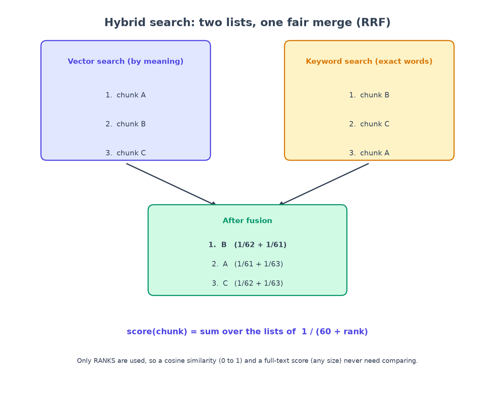

# Chapter 5: Hybrid search and reranking, with real failures

*Two ways of searching beat one, and a careful second opinion beats both.*

**You will learn:** how vector search and keyword search differ, how to merge two ranked lists fairly (RRF), what a reranker does, and how to debug a search by looking at every stage.
**You will build:** pgvector search, Postgres full-text search, Reciprocal Rank Fusion, a reranker, and a diagnostic endpoint.
**Time:** about 2.5 hours. **Code:** `backend/app/rag/retrieval/`, `backend/app/embeddings/fake.py`.

---

## Two kinds of "similar"

Imagine looking for a book in a library:

- **Keyword search** is the index card catalogue. Ask for "parental leave" and it finds cards containing exactly those words. Great for exact terms: an error code, a policy number, an acronym, "401(k)". Useless if the book says "maternity and paternity time off".
- **Vector (semantic) search** goes by *meaning*. The question and every passage were turned into number lists (embeddings, chapter 4); the closest lists win. It handles paraphrase, but it can blur exact details: "$500" and "$5,000" look nearly identical to it.

Each fails where the other succeeds, so we use **both** and merge the results. This is called **hybrid search**.

## Step 1: vector search in Postgres

With the `pgvector` extension, vector search is one SQL clause. Our chunks table has an `embedding VECTOR(384)` column and an index built for speed (`HNSW`, a graph that finds near neighbours without checking every row):

```python
distance = Chunk.embedding.cosine_distance(embedding)
stmt = (
    select(Chunk, Document.title, (1 - distance).label("score"))
    .join(Document, Document.id == Chunk.document_id)
    .where(Chunk.collection_id.in_(allowed_collection_ids), Document.status == "ready")   # the ACL filter (chapter 3)
    .order_by(distance, Document.filename, Chunk.ord)
    .limit(limit)
)
```

One subtle thing. A fast approximate index plus a restrictive `WHERE` can return *fewer rows than you asked for*, because the index finds its neighbours first and the filter then removes some. pgvector has a setting for this (`hnsw.iterative_scan`) that keeps searching until enough rows pass the filter. We switch it on for each search, because with permissions, "the filter removes most rows" is the normal case, not the exception.

## Step 2: keyword search in Postgres

Postgres can index text for keyword search too (`tsvector`). We store a searchable version of each chunk (title, headings and text) in a column, with a "GIN" index. The query turns the question into a list of terms joined by OR:

```python
def build_tsquery(query: str) -> str | None:
    """OR together the alphanumeric terms. Only [A-Za-z0-9] survives, so the string is safe for to_tsquery,
    and OR (not AND) lets a long natural-language question still match on its informative words."""
    terms = list(dict.fromkeys(t.lower() for t in _TERM.findall(query)))
    return " | ".join(terms) if terms else None
```

Two decisions in those few lines:

- **OR, not AND.** "How many weeks of paid parental leave do primary caregivers get?" has many words. Requiring *all* of them would match almost nothing. With OR, a passage matches if it has *some*, and the ranking puts the ones with *most* first.
- **Safety.** Only letters and digits survive, so a user cannot smuggle search-syntax characters into the query. A unit test sends `'; DROP TABLE chunks; --` and checks the result is just `drop | table | chunks`.

## Step 3: merge two lists fairly with RRF

We now have two ranked lists. How do we combine them? You cannot just add the scores: a vector similarity is between 0 and 1, a keyword score can be any size. They are different currencies.

**Reciprocal Rank Fusion (RRF)** ignores scores and uses only *ranks*. Each list gives a chunk `1 / (60 + rank)` points; a chunk's final score is the sum.



```python
for ranking in rankings:
    for rank, chunk in enumerate(ranking, start=1):
        scores[chunk.chunk_id] = scores.get(chunk.chunk_id, 0.0) + 1.0 / (k + rank)
```

A chunk that **both** lists like rises to the top. A chunk only one list likes still gets credit. No tuning, no normalising. (The "60" comes from the original paper and just controls how quickly the credit falls with rank.) A unit test checks the arithmetic by hand: chunk B, ranked 2nd in one list and 1st in the other, scores `1/62 + 1/61`.

## Step 4: a second opinion (reranking)

Both searches compare the question to each passage *separately*, as two independent number lists. A **reranker** (a "cross-encoder") reads the question and a passage *together*, like a person checking whether *this* paragraph actually answers *this* question. It is slower, so we only use it on the short list: the top **30** from the merge, cut down to the best **6**, which are what the AI model sees.

- Real use: a small local cross-encoder model.
- Offline stand-in: a "lexical" scorer that looks at the pair jointly (how many of the question's informative words and word-pairs appear in the passage). It is deterministic, so experiments are repeatable.

All of this is wired together from a small configuration object, not from code forks:

```python
@dataclass(frozen=True)
class PipelineConfig:
    retrieval_mode: Literal["vector", "hybrid"] = "hybrid"
    rerank: bool = True
    candidate_k: int = 30
    top_k: int = 6
```

That is why an *experiment* in chapter 7 ("vector only versus hybrid, with and without rerank") is just a list of four configs.

## Step 5: look inside, with an "explain" endpoint

When an answer is wrong, the first question is always *where did it go wrong?* So `GET /retrieval/explain` returns what **each stage** produced: the vector list, the keyword list, the fused list and the reranked top 6, each with rank, score and a snippet. Here is real output for the question *"Which days of the week am I expected to be in the office?"*:

```text
reranked rank 1  1.05  Remote and Hybrid Work   "Acme Robotics follows a hybrid model. Employees in roles that do not n..."
reranked rank 2  0.53  On-Call Rotation
reranked rank 3  0.53  Onboarding Guide
vector rank of "Remote and Hybrid Work": 1      keyword (FTS) rank: 4
```

The right page is found and ranked first. Notice that the vector search found it at rank 1 while the keyword search had it at rank 4: the words "days", "week" and "office" appear in many pages, but the *meaning* matched. This is the kind of thing you cannot see without a diagnostic.

(The endpoint shows each caller only what their own permissions allow, so it can be given to a coding agent safely. Chapter 12.)

## Results, honestly

From the experiment matrix (chapter 7 explains the setup; every row is a real, repeatable run):

| Setup | MRR (how high the right passage ranks) |
|---|---|
| vector only | 0.91 |
| hybrid (vector + keyword) | 0.94 |
| vector + rerank | 0.98 |
| **hybrid + rerank** | **0.98** |

- **Reranking is the big win** (+0.07).
- **Hybrid helps a little** (+0.03). With a real embedding model the vector half is much stronger, so I expect this split to change. I will not claim more than I measured.
- `recall@6` was **1.00 for every setup**. The demo corpus has only 20 chunks, so the top 6 covers 30% of everything and nothing can fail to be found. MRR is the number that *can* move on this data. *Choose metrics that can move.*

## What went wrong (and what it taught me)

**The search gave different scores on identical runs.** When I ran the experiment matrix twice, hybrid's MRR was 0.94 once and 0.91 the next time, with exactly the same code and data. Same inputs should mean same outputs.

The cause: when two chunks tie (equal score), I broke the tie by *chunk id*. Chunk ids are random UUIDs made fresh every time documents are ingested, so tie-breaking changed from run to run. For a search engine that is invisible in daily use. For an evaluation that CI uses to decide whether a change made things worse, it is a coin flip.

The fix: break ties by something stable (document name, then position in the document), in the SQL `ORDER BY` *and* in the fusion code. Then I added a regression test that builds the same three-way tie 25 times with fresh random ids and checks the order never changes. After the fix three consecutive runs produced byte-identical results.

> **Lesson:** anything that decides a pass/fail gate must be deterministic. If your numbers wobble, find out why before you trust a single one of them.

## Recap

- **Vector** search finds meaning; **keyword** search finds exact terms; use **both**.
- Merge with **RRF**: ranks only, no score juggling.
- **Rerank** a short list by reading question and passage together.
- Build an **explain** tool early: you will use it for every bad answer.
- Break ties on **stable keys**.

## Try it yourself

1. Call `GET /retrieval/explain?workspace_id=...&query=401k match` as the employee. Which list ranks the Benefits page highest, vector or keyword? Why might that be?
2. In `evals/experiments.yaml` change `top_k` for one experiment to 2. What happens to recall?
3. Write a question whose answer is in a table row (try the holiday calendar). Does keyword or vector search find it first?

**Next:** [Chapter 6: make the AI cite its sources, and catch it when it lies →](06-making-llms-cite-and-catching-lies.md)
