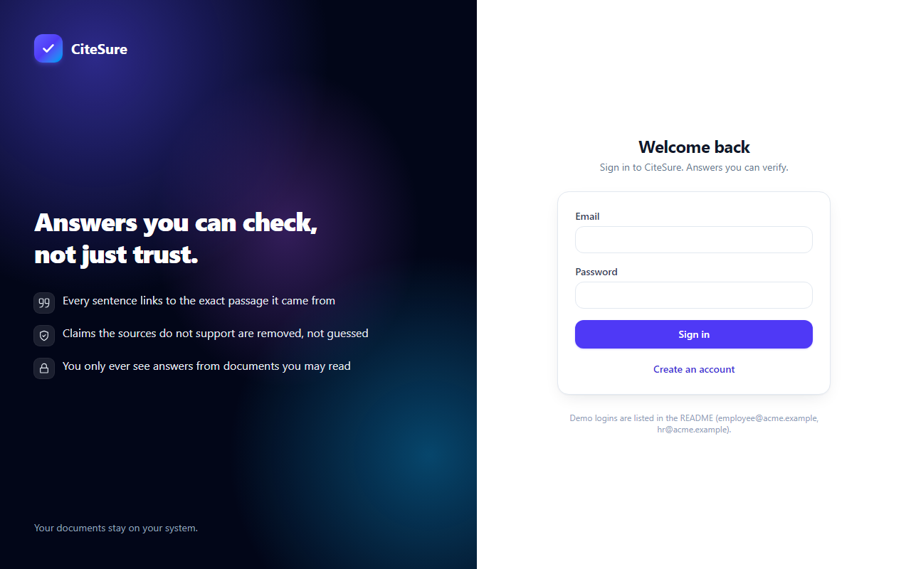
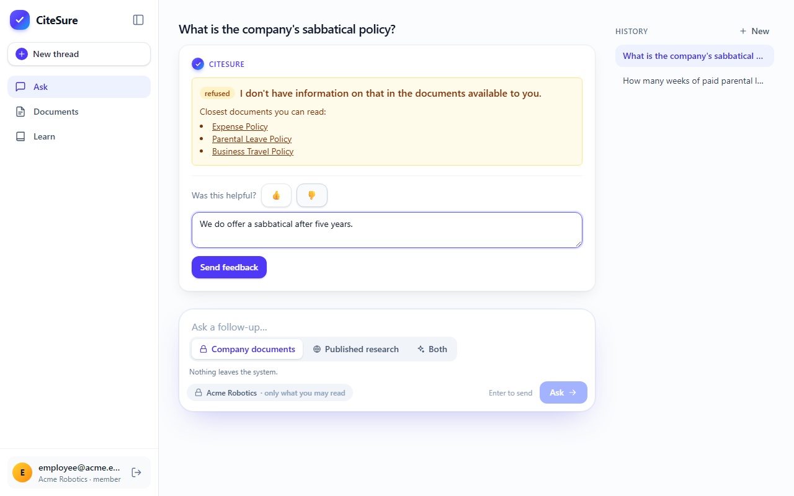
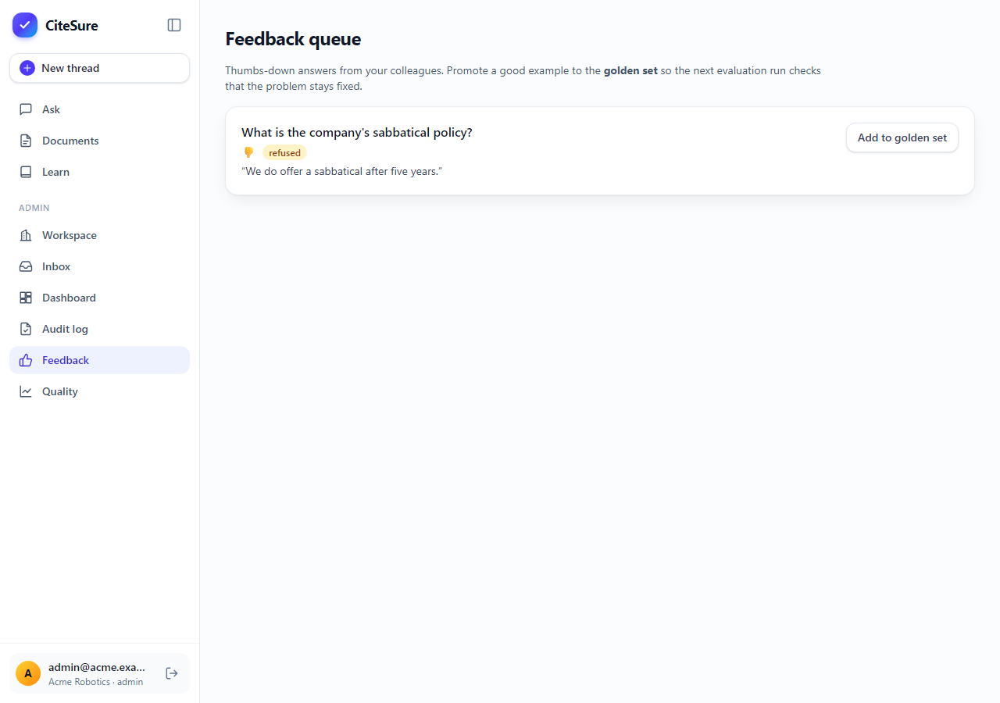

# Chapter 8: A UI people trust

*Citations change how an AI answer feels, if you design them so people can actually use them.*

**You will learn:** how to present verified answers, how to highlight the exact quoted words, how to read a streaming response, and how to test frontend logic.
**You will build:** a React app with an Ask page, source viewer, document upload with live status, workspace admin, feedback queue and quality dashboard, and well over a hundred tests (59 when this chapter was first written, 165 now).
**Time:** about 4 hours. **Code:** `frontend/src/` (`api/`, `lib/`, `components/`, `pages/`).

---

## What "trust" looks like on screen

A chatbot answer is a paragraph. You either believe it or you do not. A CiteSure answer is a paragraph where **every sentence has a number**, and every number opens the evidence:


Three details do the work:

1. **Numbered chips** after each claim (`[1]`). Sources are numbered in order of first appearance; the same passage cited twice keeps one number.
2. **A source list under the answer** with the document, the section, and the *quoted words*, so you can often verify without clicking at all.
3. **A line of honesty:** *"Every citation was checked against its source."* If verification removed anything, it says so: *"2 statement(s) were removed because the sources did not support them."*

Click a chip and the **source viewer** opens with the quoted words highlighted in the original passage:


And when the system does not know, it says so plainly, and offers somewhere to look. It never shows a document the user cannot read:


## How the frontend is organised

```text
frontend/src/
  api/        client.ts (typed HTTP, generated types), stream.ts (SSE), hooks.ts (TanStack Query)
  auth/       who is signed in, which workspace is selected
  components/ AnswerView, SourceViewer, FeedbackBar, Layout, small UI pieces
  pages/      Login, Ask, Documents, Workspace, Feedback, Quality (later: Learn, Inbox, Dashboard, Audit)
  lib/        pure logic: citations, highlight, stream reducer, metrics  (all unit-tested)
```

One rule keeps it tidy: **pages never call the network.** They use hooks from `api/hooks.ts`, which use the one typed client in `api/client.ts`. A lint rule (`no-restricted-globals` for `fetch`) fails the build if anyone calls `fetch` elsewhere. When the backend changes, there is exactly one place to look.

The other rule: put anything that is *logic* (not layout) into plain functions in `lib/`, where it can be tested without a browser. That is where most of the tests live.

## Detail 1: numbering citations

```ts
export function numberCitations(answer) {
  const sources = []; const index = new Map();
  const claims = answer.claims.map((claim) => {
    const numbers = [];
    for (const citation of claim.citations) {
      const key = `${citation.chunk_id}:${citation.quote_start}:${citation.quote_end}`;
      let number = index.get(key);
      if (number === undefined) { number = sources.length + 1; index.set(key, number); sources.push({ number, citation }); }
      if (!numbers.includes(number)) numbers.push(number);
    }
    return { text: claim.text, numbers };
  });
  return { claims, sources };
}
```

Tests check: numbered in order of first appearance; the same source cited twice gets one number; different quotes from one passage are different sources; an answer with no claims gives nothing.

## Detail 2: highlighting, and a character-counting trap

The server tells us *where* in the chunk the quote sits: `quote_start` and `quote_end`. Highlighting looks easy: split the text at those positions. It has a trap.

The backend is written in Python, which counts characters as **Unicode code points**. JavaScript counts **UTF-16 code units**. For ordinary letters they agree. For an emoji (which JavaScript stores as *two* units but Python counts as *one*) they disagree, and the highlight slides one character to the right for every emoji before the quote.

So the frontend converts:

```ts
export function codePointToUtf16(text: string, codePointIndex: number): number {
  let utf16 = 0, seen = 0;
  while (utf16 < text.length && seen < codePointIndex) {
    const code = text.codePointAt(utf16) ?? 0;
    utf16 += code > 0xffff ? 2 : 1;
    seen += 1;
  }
  return utf16;
}
```

And there is a test with an emoji *in front of* the quote to prove the right words are highlighted:

```ts
const text = "😀😀 Leave is 16 weeks long.";
const pythonStart = [...text].indexOf("1");        // what the backend would send
const highlighted = segmentText(text, [{ start: pythonStart, end: pythonStart + 8 }]).filter(s => s.highlighted);
expect(highlighted.map(s => s.text)).toEqual(["16 weeks"]);
```

(The same file also merges overlapping ranges, clamps out-of-range values and handles highlights at the very start or end.)

## Detail 3: streaming the answer

The user should see progress ("Searching...", "Writing...", "Checking every citation...") rather than a spinner for six seconds. The server sends **Server-Sent Events** (SSE): a response that stays open and delivers messages like

```text
event: stage
data: "retrieving"
```

The browser has a built-in `EventSource` for this, but it cannot send a POST body or an `Authorization` header, and we need both. So we read the response body ourselves and parse it:

```ts
export function parseSse(buffer: string) {
  const parts = buffer.split("\n\n");
  const rest = parts.pop() ?? "";           // an unfinished event stays for the next network chunk
  ...
}
```

The unfinished-tail line matters: a network packet can end in the middle of an event. A test feeds an event split in half and checks it arrives intact once.

The events feed a small **state machine** (a reducer): `idle → streaming → done | error`. It holds the current stage, the text so far and the final answer, and it ignores late messages after the stream has ended. Eight tests cover it. Recall from chapter 6 that the `token` events only ever carry **verified** text, sent after verification finishes.

## Other details worth stealing

- **Polling with TanStack Query.** While any document is `queued`, `parsing` or `embedding`, the document list refetches every 1.5 s; when all are done, polling stops by itself:
  ```ts
  refetchInterval: (query) => (query.state.data?.some((d) => PENDING.has(d.status)) ? 1500 : false)
  ```
- **Sign-out clears the cache.** One user's answers and documents must never sit in memory for the next person on the same browser (`queryClient.clear()`).
- **Storage can fail.** The token and the selected workspace go in `localStorage`, wrapped in `try/catch`, because private windows and strict settings make it throw. The app must still work without it.
- **Admin pages are hidden for members**, but that is only a convenience: the real protection is the server (chapter 3). A hidden menu item is not security.
- **Accessibility basics:** the source viewer is a real `role="dialog"` with `aria-modal`, closes on Escape, buttons have labels, and the tests find elements by role and label (which doubles as an accessibility check).

## The other screens



| Screen | What it is for |
|---|---|
| **Documents** | collections as tabs, files with live status (`queued` to `ready`), upload/delete/reindex for admins |
| **Workspace** | members, groups, and collections, including who may read a restricted one |
| **Feedback** | thumbs-down comments; an admin can promote one into the golden set (with a required reason) |
| **Quality** | run the evaluation, see runs, compare two (green = better, red = worse) |


Feedback: a thumbs-down with a comment, and the admin queue where it can be promoted into the golden set.





## Testing a frontend

| What | How |
|---|---|
| Pure logic (citations, highlight, reducer, metrics, SSE parsing) | plain Vitest unit tests, no browser |
| The HTTP client | stub `fetch` and check the `Authorization` header, the 401 handling, and the error type |
| Components and pages | React Testing Library: render, click, assert on what a person would see |
| The Ask page | a fake streaming backend; asserts the stages, the answer, the chips, a refusal, an error message, and that feedback is sent |

Run them with `cd frontend && npm run test`. Also `npm run lint`, `npm run typecheck` and `npm run build`.

## Screens added later

The app grew after this chapter: a **PDF viewer** that opens citations on the real page, **Learn** (study sets, plans, reading progress), and admin pages for **watched folders**, a **dashboard** and an **audit log**. They follow the same two rules (network code in one folder, logic in plain functions). Chapter 16 shows them.

## What went wrong (and what it taught me)

Four real surprises, each worth knowing:

1. **My stub never took effect.** The typed client captured `fetch` *when it was created*, so tests that replaced `fetch` later changed nothing, and my tests hit a real network (`ECONNREFUSED`). Fix: look `fetch` up on every call. Real benefit: tests can stub it, and polyfills still apply.
2. **Relative URLs fail outside a browser.** In a browser `"/api/v1/ask"` works. In the test environment, building a request object from a relative URL throws `Invalid URL`. Fix: build the base URL from `window.location.origin`.
3. **A test hook that ran my mock.** One test failed with the exact error message I had told the mock to throw, and I could not see where it came from. The cause: `beforeEach(() => signIn.mockReset())`. Arrow functions *return* their expression, `mockReset()` returns the mock function, and the test framework treats a function returned from `beforeEach` as a **cleanup callback and calls it**. So after each test it called my mock, which dutifully rejected. Fix: use braces, `beforeEach(() => { signIn.mockReset(); })`.
4. **The browser test found a real bug the unit tests could not.** (Chapter 9: a 500 on the members page.)

## Recap

- Trust comes from **numbered, clickable, verifiable citations** and honest refusals, not from fluent text.
- Keep **network code in one folder**, **logic in pure functions**, and enforce it with lint.
- Beware **code points vs UTF-16** when mapping offsets across languages.
- Read SSE yourself when you need POST and headers; handle **partial chunks**.
- Test what a person sees; and watch for test-framework gotchas.

## Try it yourself

1. Open the app, ask a question, click each citation. Is there any claim you cannot verify from the source list alone?
2. Add an emoji at the start of `corpus/demo/general/parental-leave.md`, reindex it, ask the leave question and check the highlight is still correct (then remove the emoji).
3. In `streamReducer.ts`, what happens if a `token` event arrives after `final`? Find the test that proves it.

**Next:** [Chapter 9: testing a RAG system →](09-testing-a-rag-system.md)
