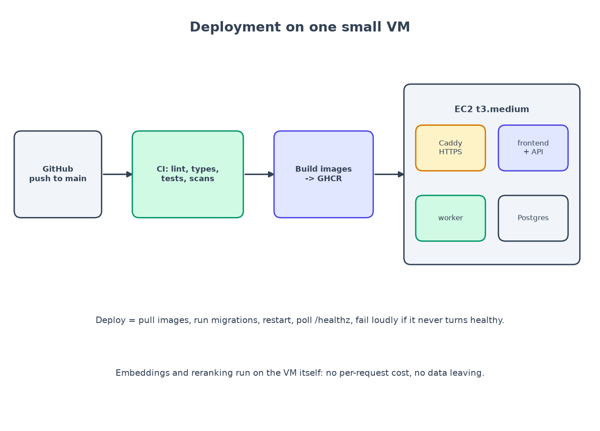

# Chapter 10: Ship it

*Docker, CI/CD, and an honest note about deployment.*

**You will learn:** how to package an app so it runs the same everywhere, how to let GitHub test every change automatically, and how a deploy pipeline works.
**You will build:** multi-stage Docker images, a Compose file that starts everything, three GitHub Actions workflows, and a production setup for one small server.
**Time:** about 3 hours. **Code:** `backend/Dockerfile`, `frontend/Dockerfile`, `docker-compose.yml`, `docker-compose.prod.yml`, `.github/workflows/`, `deploy/Caddyfile`, `docs/deployment.md`.

---

## "It works on my machine"

The classic problem: the app runs on your laptop but not on the server, because the server has a different Python version, a missing library, or a different database. **Docker** solves it by packaging the app *and* everything it needs into an **image**. A running copy of an image is a **container**. Anyone with Docker gets the same environment.

**Docker Compose** describes *several* containers working together in one file: the database, the web server, the background worker. One command starts them all.



## Step 1: the backend image

The same image runs the API, the worker, the database migrations and the seed script. Only the *command* differs. It is built in stages:

```dockerfile
FROM python:3.12-slim AS deps         # stage 1: install the libraries (cached until dependencies change)
...
RUN uv sync --frozen --no-dev --no-install-project $EXTRA

FROM python:3.12-slim AS runtime      # stage 2: the small image that actually runs
RUN useradd --create-home --uid 10001 app
COPY --from=deps /srv/citesure/backend/.venv ./.venv
COPY backend/ ./
USER app                              # not root
HEALTHCHECK ... http://127.0.0.1:8000/healthz
CMD ["uvicorn", "app.main:app_factory", "--factory", "--host", "0.0.0.0", "--port", "8000"]
```

Why two stages? The final image contains no compilers and no package-manager cache, so it is smaller and has less in it for an attacker to use. Why not root? If someone breaks into the app, they should not be the most powerful user inside the container. (A security scanner reminded me of that for the *frontend* image: more below.)

Two optional build switches: `WITH_ML=true` downloads the local embedding and reranking models **at build time** and bakes them into the image, so the running app never needs the internet; `WITH_S3=true` adds `boto3` for storing uploads in an S3 bucket.

## Step 2: the frontend image

A Node image builds the React app into plain files; a tiny **nginx** web server serves them. nginx also *forwards* anything starting with `/api` to the backend, so the browser only ever talks to one address (no cross-origin headaches). One setting matters a lot:

```nginx
location /api/v1/ask/stream {
  proxy_pass http://api:8000;
  proxy_buffering off;          # Server-Sent Events must not be buffered...
  proxy_read_timeout 300s;
}
```

If nginx buffers the stream, the "Searching... Writing... Checking..." messages arrive all at once at the end, and your progress indicator is a lie.

## Step 3: Compose runs everything

```bash
docker compose up -d --build                    # database + migrations + api + worker + frontend
docker compose run --rm api python -m app.seed  # demo users, 2 collections, 20 documents, 40 golden questions
```

What the file arranges:

- **db**: Postgres 16 with pgvector, with a health check (`pg_isready`).
- **migrate**: a one-shot container that runs the database migrations and exits. The API and worker wait until it has *completed successfully*.
- **api** and **worker**: the same image, different commands.
- **frontend**: nginx on port 5173.

I ran this for real. Here is the stack, and then a question asked **through nginx**, the way a browser would:

```text
$ docker compose ps
api        Up (healthy)
db         Up (healthy)
frontend   Up (healthy)
worker     Up (healthy)

$ curl -s http://localhost:5173/healthz
{"status":"ok","database":true}

answered | Primary caregivers receive 16 weeks of fully paid leave. | Parental Leave Policy
refused  | I don't have information on that in the documents available to you.
```

(The second answer is the *restricted* question asked as the plain employee.)

## Step 4: CI, a robot that tests every change

**Continuous Integration** means: every time you push code, a server runs all the checks. Nobody can forget. The workflow `.github/workflows/ci.yml` has parallel jobs:

| Job | What it runs |
|---|---|
| contract | lint `openapi.yaml`; the golden set still matches the corpus; the golden set is append-only; every Action is pinned; agent pack copies are in sync |
| backend | `ruff` (style), `mypy` (types), unit tests, integration tests (the runner has Docker, so testcontainers works) |
| frontend | regenerate the API client and fail if it differs from the committed one; lint, typecheck, test, build |
| agent-pack | hook tests, MCP server tests, nightly-agent tests |
| e2e | `docker compose up`, seed, run the Playwright browser tests |
| security | gitleaks, Semgrep, Trivy, `pip-audit`, `npm audit` |
| images | build both images and scan the backend image |

The second workflow, `rag-eval.yml`, is the quality gate from chapter 7: on pull requests that touch search code, run the experiment matrix with the fake providers, fail if restricted refusal is below 100% or any metric falls more than 0.02 below the baseline. On a schedule it runs the *real* models and opens an issue when something regresses.

## Step 5: CD, a robot that deploys

**Continuous Delivery**: when the checks pass on `main`, ship it. `deploy.yml` does:

1. build both images and push them to the GitHub container registry,
2. copy the compose files to the server,
3. over SSH: pull the images, **run the database migrations**, restart,
4. poll `/healthz` for up to two minutes; if it never turns healthy, **fail the run and print the logs**.

Safety details: it only runs after a **green** CI run that was triggered by a **push to this repository** (not a pull request from a fork; more in chapter 13); it uses a protected `production` environment; and it deploys images tagged with the exact commit, so rolling back is "deploy an older commit".

The production Compose file publishes **only Caddy** (ports 80 and 443). Caddy gets a free HTTPS certificate automatically. The database and the API are not reachable from outside. The app refuses to start in production with a default JWT secret or a wildcard CORS setting.

## An honest note about deployment

I wrote the pipeline, the production compose file, the Caddy config and a step-by-step runbook (`docs/deployment.md`). The production images build, and every command in them was tested locally. But **I did not deploy to AWS**: that needs an account, a domain and secrets, and the project rules say never deploy without explicit permission. The same goes for the GitHub Actions workflows: they are valid and pinned, and every command inside was run locally, but I could not run GitHub itself. So the rubric's "deployed with a working URL" is **not** claimed. If you follow the runbook you will have it running in about 30 minutes.

I think saying so plainly is worth more than a screenshot of someone else's server.

## What went wrong (and what it taught me)

Four things the running stack and the scanners told me:

1. **The worker always said "unhealthy".** It inherited the API's health check (probing port 8000), which a worker never serves. It had been running fine; the label was just wrong, and a permanently red label hides the day it is *really* broken. Fix: a worker-specific check against its own metrics port.
2. **The frontend ran as root.** Trivy flagged the nginx image (HIGH). Fix: the "unprivileged" nginx image on port 8080; I verified it runs as `uid=101(nginx)`.
3. **A deployment-triggering workflow could be triggered by a stranger.** Semgrep flagged the `workflow_run` pattern: a pull request from a *fork*, with a branch also named `main`, could set off a workflow that has access to secrets. Fix: require the triggering run to be a push from this repository.
4. **Pin your supply chain.** Semgrep also flagged every `uses: actions/checkout@v4`: a tag can be moved by its owner. I now pin each action to a full commit SHA (a small script does it and a CI step checks it).

## Recap

- **Docker** packages the app; **Compose** runs several containers as one system.
- Build in **stages**, run as **non-root**, add **health checks**, bake in anything you would otherwise download at runtime.
- **CI** runs every check on every push; **CD** ships only what passed.
- Make deploys **fail loudly** (poll the health endpoint), and make them **roll back-able** (tag images by commit).
- Say plainly what you did **not** do.

## Try it yourself

1. `docker compose up -d --build`, seed, and ask a question through `http://localhost:5173`. Then `docker compose logs worker` while you upload a document.
2. Break the health check on purpose (stop the database). What do `docker compose ps` and `/healthz` show?
3. Read `docker-compose.prod.yml`. List everything that is *not* published to the internet. Why is each one safe to keep private?

**Next:** [Chapter 11: watching a RAG system in production →](11-observing-rag.md)
