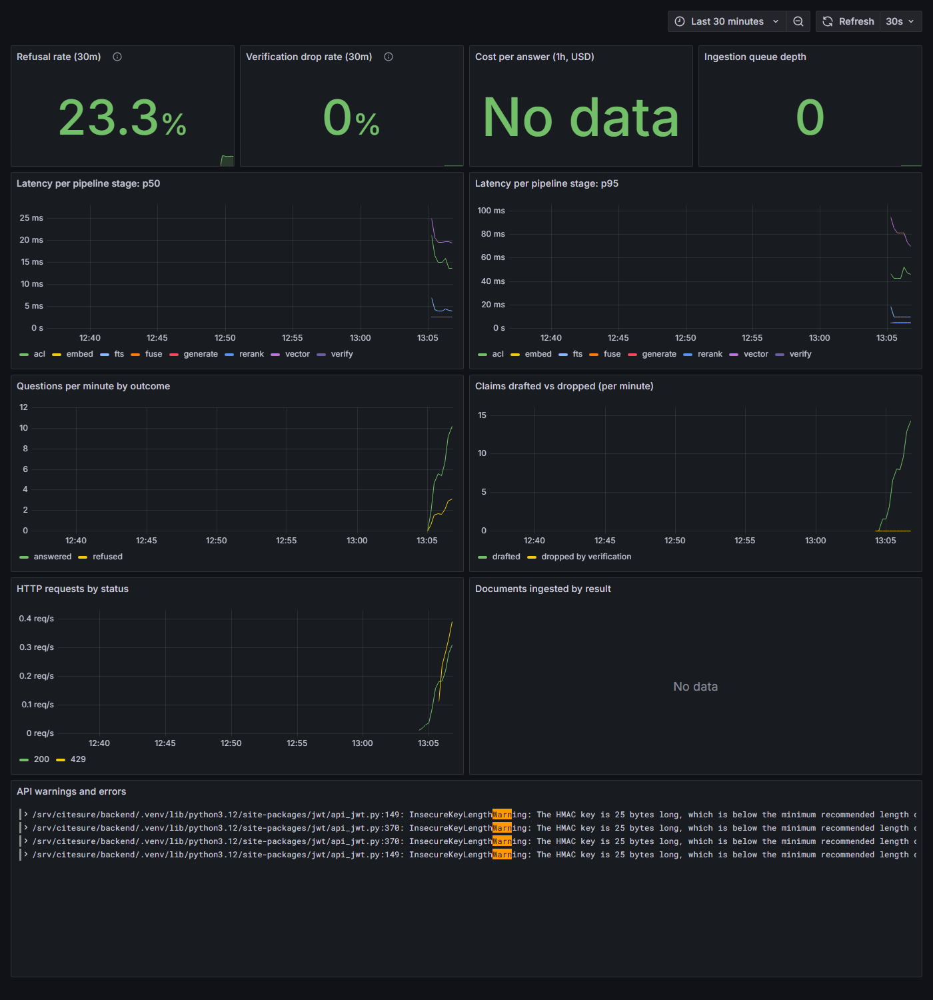

# Chapter 11: Watching a RAG system in production

*Graph the right things. Alert on the right changes.*

**You will learn:** the difference between "the server is up" and "the answers are good", which numbers a RAG system must expose, and how to turn them into dashboards and alerts.
**You will build:** metrics in the API and the worker, Prometheus alert rules, a Grafana dashboard, and tracing and logging with OpenTelemetry, Tempo and Loki.
**Time:** about 2 hours. **Code:** `backend/app/observability.py`, `ops/`.

---

## Why a RAG app needs more than "is it up?"

A normal web service has a clear failure: errors and slowness. A RAG system has a worse one: it can be up, fast and **wrong**, with every request returning 200 OK.

A bad reindex, a model change or a corpus update will not raise an exception. It will quietly change *how often the system refuses* or *how many claims get thrown away*. Those two numbers are your early-warning system, and generic dashboards do not have them.

## What to expose

`backend/app/observability.py` defines a handful of Prometheus metrics. Prometheus is a program that visits `/metrics` every 15 seconds and remembers the numbers.

| Metric | What it counts | What it tells you |
|---|---|---|
| `citesure_ask_total{status}` | questions, by `answered` or `refused` | **refusal rate**: the first early-warning signal |
| `citesure_claims_drafted_total` and `..._dropped_total` | claims the model wrote, and claims verification removed | **drop rate**: the model's honesty, measured |
| `citesure_stage_latency_seconds{stage}` | time per stage: `acl`, `embed`, `vector`, `fts`, `fuse`, `rerank`, `generate`, `verify` | which stage got slow |
| `citesure_ask_cost_usd_total` | estimated spend | a runaway loop, or abuse |
| `citesure_job_queue_depth` | waiting background jobs | the worker is stuck |
| `citesure_ingest_documents_total{status}` | documents processed, by result | ingestion health |
| `citesure_http_requests_total{method,status}` | every request | 5xx rate, 429s (rate limiting) |

Timing a stage is one `with` block, which also opens a tracing span:

```python
with timer.stage("rerank"):
    trace.reranked = await rerank(reranker, query, trace.fused, config.top_k)
```

The same timings are saved on every answer (`latency_ms_by_stage`), so you can also find the slow *question*, not just the slow average.

**The worker has its own port.** The API and the worker are separate processes; counters in one are invisible to the other. So the worker starts a tiny metrics server on port 9100, and Prometheus scrapes both.

**Privacy rule:** metrics, spans and logs carry *ids, sizes and timings*, never the question or the document text. The OpenTelemetry collector even has a processor that deletes `question` and `chunk.text` attributes, as a second line of defence.

## The dashboard

`ops/grafana/dashboards/citesure.json` is loaded automatically by Grafana. I generated real traffic against the running stack and took this screenshot:



Top row, left to right: **refusal rate**, **verification drop rate**, **cost per answer**, **queue depth**. Below: p50 and p95 latency for *each stage*, questions per minute by outcome, claims drafted versus dropped, HTTP requests by status, documents ingested, and a **logs** panel that shows warnings and errors from both containers (Loki collects Docker logs through Promtail).

Start it with one command:

```bash
docker compose -f docker-compose.yml -f ops/docker-compose.observability.yml up -d
# Grafana http://localhost:3000   Prometheus http://localhost:9090
```

## Alerts that matter

`ops/prometheus/alerts.yml` has eight rules in three groups. I validated them with Prometheus's own checker (`promtool check rules`: "SUCCESS: 8 rules found") and confirmed in the running Prometheus that all three groups loaded.

| Alert | Fires when | Likely cause |
|---|---|---|
| **RefusalRateSpike** | more than half of questions refused for 15 minutes (and enough traffic to matter) | retrieval regression, a bad reindex, a corpus or permission change |
| **VerificationDropRateSpike** | over 30% of drafted claims fail verification | a model or prompt change; quotes no longer matching (parsing change) |
| ApiDown / WorkerDown | the scrape target is down | crash |
| ServerErrors | over 5% of requests are 5xx | bug or database trouble |
| IngestionBacklog | more than 50 jobs waiting for 15 minutes | stuck worker |
| LlmSpendHigh | over $5 estimated spend in an hour | abuse or a loop |
| SlowAnswers | p95 generation latency over 8 s | slow model |

The `for: 15m` and the "and enough traffic" clause matter: without them a single refused question at 3 a.m. would page someone. A good alert is **rare, actionable and explains itself**: each one carries a description and points at the runbook in `docs/architecture.md`.

## Tracing: following one request

With `OTEL_EXPORTER_OTLP_ENDPOINT` set, the API and worker send **spans** (one per stage) to an OpenTelemetry Collector, which forwards them to **Tempo**. In Grafana you can open a single slow question and see the timeline: 4 ms to check permissions, 12 ms to embed, 90 ms to generate... I confirmed spans arrive by querying Tempo's search API from inside the stack after sending traffic.

## Dev, test and prod are different on purpose

| | dev | test | prod |
|---|---|---|---|
| Providers | fake | fake | real |
| `/docs` page | on | n/a | **off** |
| `/metrics` | open on the dev port | n/a | **blocked at the proxy** (Prometheus reads it on the internal network) |
| Tracing | off unless set | off | on |
| Secrets | built-in dev values (with a warning) | fixed test values | required, checked at startup |

## What went wrong (and what it taught me)

The dashboard paid for itself on the first screenshot:

1. **The logs panel showed a security warning I had never seen in a terminal:** `InsecureKeyLengthWarning: The HMAC key is 25 bytes long, which is below the minimum recommended length`. My *development* JWT secret was shorter than recommended for the signing algorithm. Nothing was broken, so I would never have noticed without a place where all logs land together. Fix: a longer default, plus a startup warning whenever the built-in secret is in use. (Production already refuses short secrets.)
2. **The HTTP panel showed `429` responses.** That was my traffic generator hitting the per-user rate limit (30 questions a minute). A good sign: the limiter works, and now I can *see* it working.
3. **"Cost per answer: No data".** With fake models the cost counter is always zero, and my query returned nothing instead of 0. Fix: `or vector(0)`. A dashboard that shows "No data" when the answer is "zero" invites mistrust.
4. **Every worker looked unhealthy** (chapter 10): the check was wrong, not the worker. Fixing it made the *next* real failure visible.

## Recap

- A RAG system can be up and wrong: graph **refusal rate** and **verification drop rate**.
- Time **every stage**, per request and as histograms.
- Give **every process** its metrics endpoint.
- Alerts should be **rare, actionable and explained**, and tested (`promtool`).
- Keep **question and document text out of telemetry**.
- Put **logs, metrics and traces** in one place: they find things you did not know to look for.

## Try it yourself

1. Start the observability stack, ask 20 questions, and find the p95 of the `rerank` stage.
2. Temporarily set `FAKE_MIN_COVERAGE=0.9` for the API container and watch the refusal rate rise. How long until the alert would fire?
3. Open Tempo's search in Grafana and find a trace for `/ask`. Which stage dominates?

**Next:** [Chapter 12: giving coding agents safe access →](12-agent-extension-pack.md)
