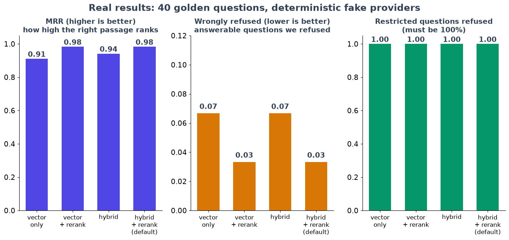

# Chapter 14: Lessons, results, and what to do next

*What worked, what did not, how to describe it honestly, and how to run it yourself.*

**You will learn:** how to summarise a project with real numbers (and without overclaiming), the ten lessons that cost me the most time, and what I would build next.
**Time:** about 30 minutes to read.

---

## The result in one picture



Measured on the 40-question golden set, with the fake (deterministic) AI parts:

| Setting | MRR (is the right chunk near the top?) | Wrongful refusals | Restricted questions refused |
|---|---|---|---|
| vector search only | 0.91 | 7% | 100% |
| **hybrid + rerank (default)** | **0.98** | **3%** | **100%** |

Read this carefully, because it is easy to overclaim:

- **What it shows:** the plumbing works. Reranking put the right chunk first more often, and no setting ever answered a question the asker was not allowed to read.
- **What it does not show:** how good a *real* language model is. I did not run the real-model evaluation (no API key in the build environment). The workflow for it exists (`rag-eval.yml`, nightly) and has never been executed. The numbers will change when it runs.
- **The corpus is small** (20 pages), which is why `recall@6` is 1.00 for every setting and only MRR separates them.

## What exists

| | |
|---|---|
| API | 31 operations in one OpenAPI file, linted with Spectral, with a drift test |
| Backend tests | 94 unit + 73 integration (real Postgres in a container), including 17 permission-leak tests and 6 prompt-injection tests |
| Frontend tests | 59 Vitest tests |
| Browser tests | 9 Playwright tests, including the restricted-user refusal |
| Agent pack | 4 skills, 3 read-only subagents, an MCP server with 6 tools, 3 hooks (60 tests), a plugin and a nightly agent |
| Security | gitleaks, Semgrep, Trivy, pip-audit, npm audit; Semgrep 35 findings down to 1 (accepted, explained); a 16-row threat model |
| Observability | Prometheus metrics, 8 alert rules, Grafana dashboard, traces and logs |

## What does *not* exist (said plainly)

- **It is not deployed.** There is no live URL. The pipeline, production compose file, Caddy config and runbook exist and were tested locally, but I did not create AWS resources.
- **The GitHub workflows were not run on GitHub.** Every command inside them was run locally.
- **No real-model evaluation** (above).
- **No demo video**, and the live "Claude Code picks the skill by itself" session was not recorded (it is marked "to rehearse").
- **Nothing was committed.** The agent that built this was told not to, and did not.
- **A human has not reviewed** the AI-written security audit or the workflows yet. The log (`docs/ai-workflow.md`) has empty "human review" cells on purpose.

Why list these? Because a reader, an interviewer, or you in six months should be able to trust every *other* sentence.

## Ten lessons

1. **Write the exam first.** Forty questions before a line of retrieval code gave me a scoreboard for every later decision. (Chapter 1)
2. **Pick metrics that can move.** On a tiny corpus recall is stuck at 1.00. MRR moved. If a metric never changes, it is not telling you anything. (Chapter 7)
3. **Put the permission check inside the query.** Filtering afterwards leaks through scores, counts and timing. (Chapter 3)
4. **Make the model's output checkable.** Claims with word-for-word quotes turn "trust me" into a test a program can run. (Chapter 6)
5. **Verified is not the same as relevant.** A real quote can still not answer the question. Measure it, because no filter prevents it. (Chapters 7, 12)
6. **Fakes are a feature.** Deterministic fake models made every test free, fast and repeatable, and let a failing test point at *my* code. The cost: you must say clearly what the fakes cannot tell you.
7. **Your own evaluation harness has bugs.** Mine had three (random tie-breaking, a worker stealing jobs, a crashing test persona). Each would have silently corrupted conclusions. Run the evaluation three times and expect identical numbers.
8. **Errors and logs are output.** Database errors carried document text. Keep confidential text out of the error path too. (Chapter 13)
9. **A guardrail must fail closed.** My first guard let an unusual file path through. Test the weird input first. (Chapter 12)
10. **Say what you did not do.** It costs nothing and buys credibility.

## Résumé bullets (only claims you can defend)

Adapt these, and keep the numbers honest. Every figure below is measured in this repository.

- Built a permission-aware RAG system (FastAPI, Postgres/pgvector, React) in which access control is enforced inside the retrieval SQL, verified by 17 leak tests across every content endpoint and a 100% restricted-question refusal rate in all evaluated configurations.
- Designed a two-stage citation verifier (fuzzy quote match plus entailment check) that removes unsupported claims before display; evaluated on a 40-question golden set, where adding a cross-encoder reranker raised MRR from 0.91 to 0.98 and cut wrongful refusals from 7% to 3% (deterministic offline providers).
- Wrote an evaluation harness and CI regression gate (recall@k, MRR, faithfulness, citation precision/recall, refusal accuracy) and used it to run an experiment matrix of six retrieval and chunking configurations.
- Delivered an agent extension pack for Claude Code: 4 skills, 3 read-only subagents, an MCP server running as a scoped service user, guardrail hooks (60 tests) that block secret reads and edits to the golden set, a plugin, and a nightly regression agent.
- Ran gitleaks, Semgrep, Trivy, pip-audit and npm audit; fixed 34 of 35 Semgrep findings and a high-severity container issue, and found four further issues by manual data-flow review, including document text leaking into database error messages.

If you have not run a real-model evaluation or deployed it, do not write "deployed" or quote real-model quality numbers. Interviewers ask.

## How to run everything

```bash
# 1. the app (two minutes)
docker compose up -d --build
docker compose run --rm api python -m app.seed
# open http://localhost:5173  (all demo users: password citesure-demo, local use only)
#   employee@acme.example, hr@acme.example, admin@acme.example

# 2. the scoreboard
cd backend && uv run python -m app.evals.run --matrix evals/experiments.yaml

# 3. the tests
cd backend && uv run pytest -m "not integration" && uv run pytest -m integration
cd frontend && npm ci && npm run test
cd e2e && npm ci && npx playwright install chromium && npx playwright test

# 4. the monitoring stack
docker compose -f docker-compose.yml -f ops/docker-compose.observability.yml up -d   # Grafana :3000

# 5. the agent pack
python -m pytest agent-hooks/tests
```

To use real models, set `LLM_PROVIDER=anthropic`, `ANTHROPIC_API_KEY`, and `EMBEDDING_PROVIDER=fastembed` (build with `WITH_ML=true`), then run the evaluation again and **write down the new numbers**.

## What to build next

In order of value:

1. **Run the real-model evaluation** and replace the fake-provider table. This is the most important missing piece.
2. **An answer-relevance check** before returning claims. It closes the "verified but irrelevant" gap.
3. **Cookie-based sessions** with refresh rotation instead of a token in `localStorage`.
4. **Separate "manage" from "read"** for admins, so a workspace admin who is not in the HR group does not read HR files.
5. **Deploy it**, with the runbook, and put the URL in the README.
6. Record the two-minute demo, including the permission-denied scenario.
7. Stretch ideas: connectors (Drive, Confluence), multi-turn follow-ups with query rewriting, contextual chunk headers measured against the baseline, answer caching keyed by (question, permissions, corpus version).

## A last word

The system is not impressive because it uses an AI model. Anyone can call an API. It is useful because every claim it makes is **checked**, every secret stays **secret**, and every improvement is **measured**. Those three habits apply to any AI product you build.

Thank you for reading. If you build it, tell me what broke. That is the interesting part.

**Back to the index:** [The CiteSure series](00-series-index.md) · [Glossary](glossary.md)
