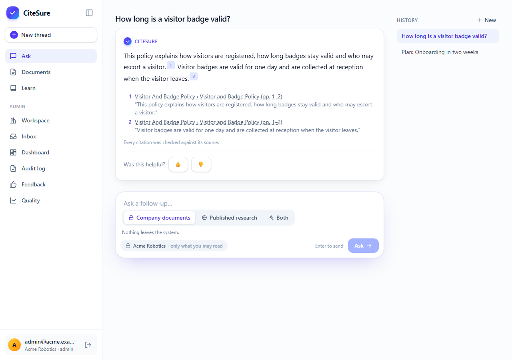
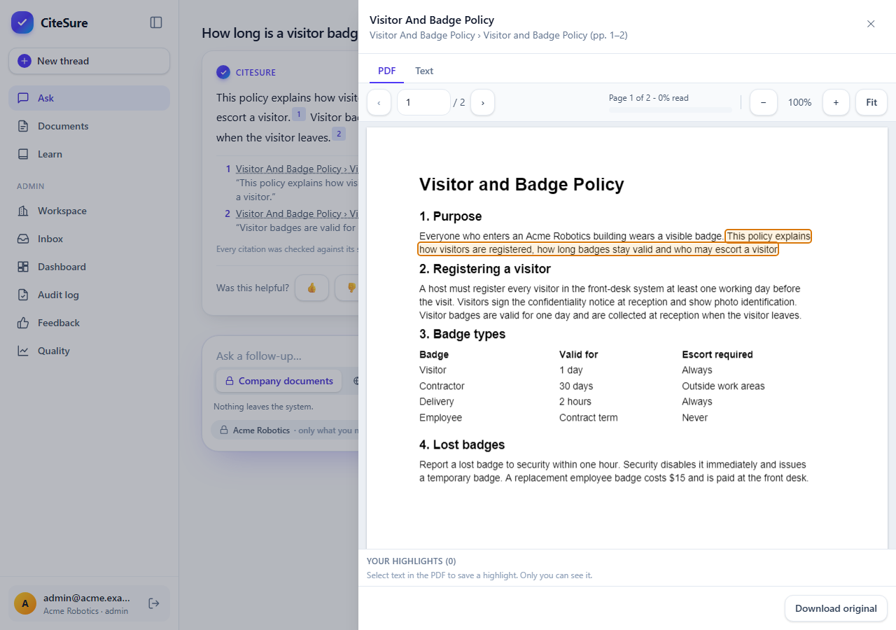
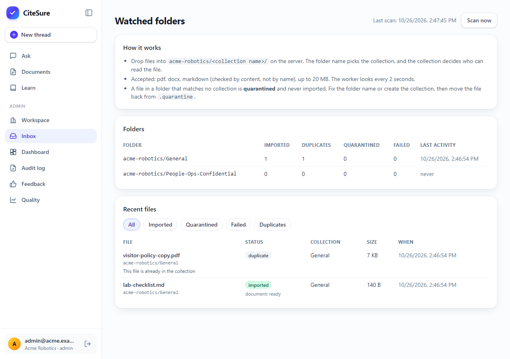
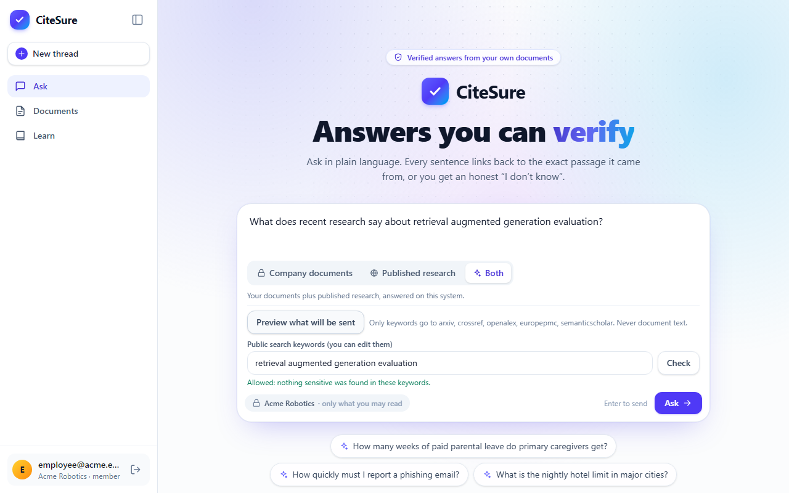
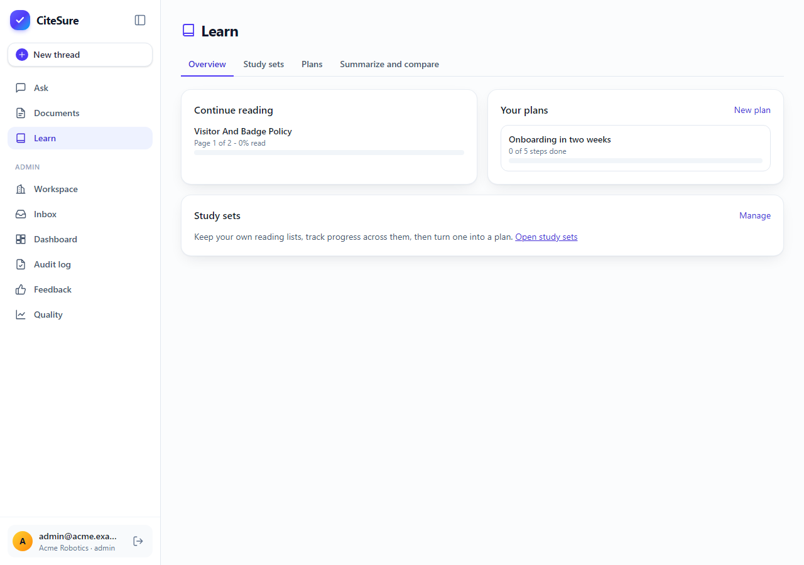
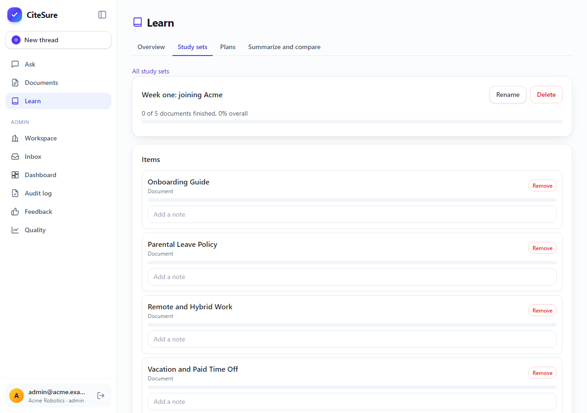
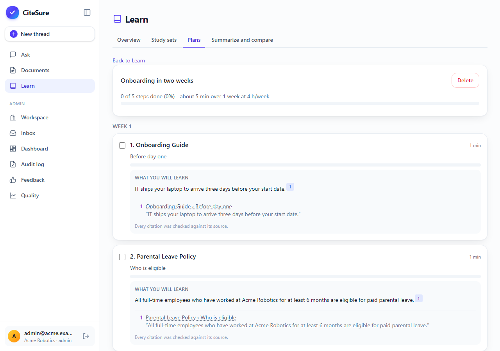
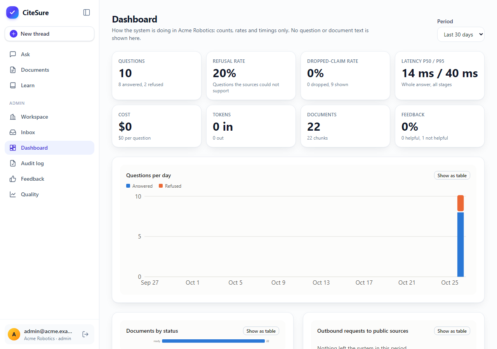
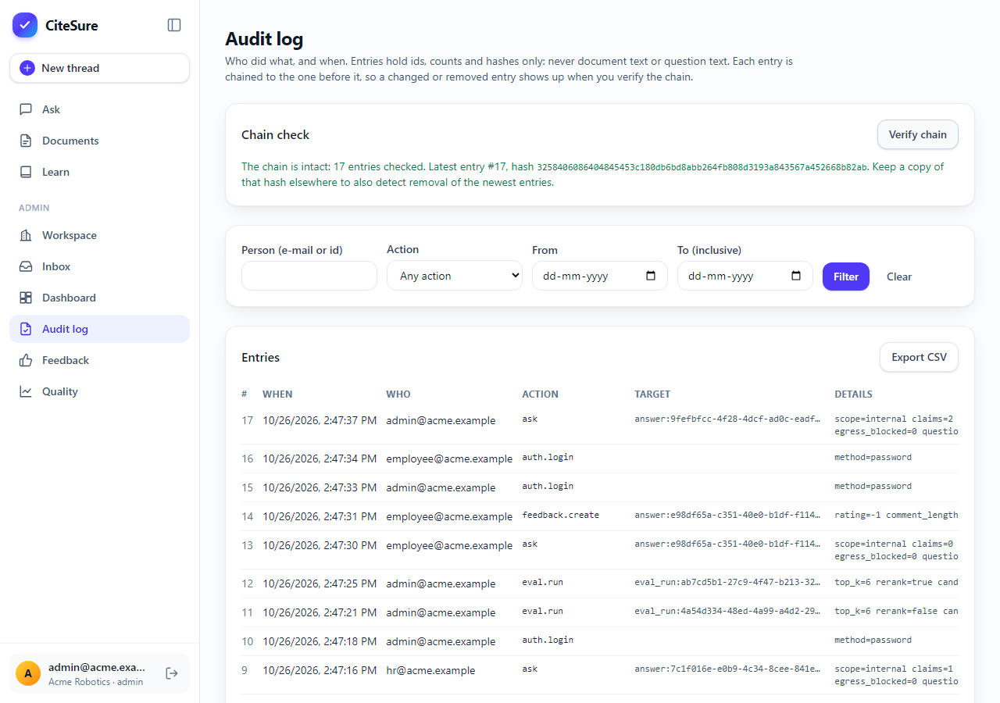

# Chapter 16: Merging a second project: the real page, a study plan and an audit trail

*What happens when two good projects overlap: pick one base, port the missing parts, and then run it for real, where the surprises live.*

**You will learn:** how to merge two projects without rewriting either, how to open a citation on the *real PDF page*, how to keep a study plan honest with the same verification as any answer, how a tamper-evident log works, and why a mocked test is not the same as running the thing.
**You will build:** a PDF viewer with a cited-quote outline, watched folders that follow your access rules, on-demand open-access full text, a learning layer, an audit log and an admin dashboard.
**Time:** about 6 hours. **Code and files:** `backend/app/rag/parsing/pdf.py`, `frontend/src/components/PdfViewer.tsx`, `backend/app/services/` (`inbox`, `fulltext`, `learning/`, `audit`), `frontend/src/pages/` (`LearnPage`, `InboxPage`, `DashboardPage`, `AuditPage`), `docs/merge-roadmap.md`.

---

## The problem

I had two projects that did almost the same job. CiteSure answers questions about company documents with checked citations. A second project of mine, `document_explorer`, was also a self-hosted, cited question-answering tool, but it had things CiteSure lacked: a real PDF viewer, folders you drop files into, a reading tracker and study plans, an audit log, and a dashboard.

Keeping two projects alive means fixing every bug twice. So I merged them, with one rule: **CiteSure is the base.** Its stack stays (FastAPI, Postgres with pgvector, its own login). Anything from the other project that depended on a different stack (Qdrant for vectors, Keycloak for login) was *re-implemented* on CiteSure's stack, or added as an **optional adapter**. Nothing new became a hard requirement.

Merging is mostly deciding what *not* to copy. I kept CiteSure's two non-negotiable rules from the start of this series: every claim is verified, and you only get answers from documents you may read. Every ported feature had to follow both.

## Step 1: read PDFs properly

The first thing a PDF viewer needs is a parser that knows where things are. The old parser (`pypdf`) gave one block of text per page. I swapped it for **PyMuPDF**, which reports each line and its position, so the parser can:

- tell headings from body text by font size, and give each section a heading path and a page number,
- rebuild **tables**: lines that share a row and have wide gaps between cells become a table, and a long table is cut into slices of 14 rows with the header repeated, so every slice still makes sense on its own.

One rule here is deliberate: a table needs **three or more columns** and at least four rows. A two-column "table" reads as prose. The reason is that a two-column research paper looks exactly like a two-column table, and splitting papers in half is a worse mistake than reading a small table as text. The limit is written down, with the test that proves it.

> **Licence note:** PyMuPDF is AGPL-3.0. That is fine for an internal deployment. If you distribute CiteSure or offer it as a service to others, either publish your source under a compatible licence or swap the PDF library.

## Step 2: open the citation on the real page

Until now, clicking a citation showed the quoted passage as text. For a PDF, you often want to see the *page*: the table next to the sentence, the figure above it.



Now a PDF source opens with two tabs. **PDF** is the real page, drawn in the browser by PDF.js, with the cited words outlined. **Text** is the old view. The toolbar shows the page, zoom, and **how much of the document you have read**.



Three choices made this safe:

1. **Everything is served by you.** The PDF.js code and its worker are bundled into the app. No script comes from a CDN. A page that promises "your documents stay on your system" cannot load code from someone else's server.
2. **The outline is computed from the quote.** The server already knows the quoted words and the page. The browser finds them in the page's text and draws the outline over them.
3. **You can highlight too.** Select text, pick a colour, add a note. Highlights are **private to you** and tied to the document, so access rules apply to them like anything else.

## Step 3: folders that follow your access rules

Uploading files one at a time does not scale. The **Inbox** watches a folder on the server. The folder structure *is* the access control:

```text
inbox/<workspace folder>/<collection name>/report.pdf
```

A file dropped into `Acme/People-Ops-Confidential/` becomes a document in *that collection*, readable only by who may read that collection. A file in a folder that matches **no** collection is **quarantined**, not imported with broader access. The admin page shows what happened to each file: imported, duplicate, quarantined or failed.



The checks run on content, not names: a `.pdf` that is really something else is refused, and a file that is already in the collection is reported as a duplicate instead of added twice. The watcher is off until you set `INBOX_ROOT`.

## Step 4: let published papers come in as full text

Chapter 15 searched arXiv, Crossref, OpenAlex and Europe PMC, and now Semantic Scholar. Those searches return **abstracts**. Often you want the whole paper.



For papers with a free, legal full text, a button fetches it **on demand**. It goes through the same egress guard as every other outbound request: an allow-list of hosts, a size limit, and a daily budget per workspace. The fetched text is stored as *public* text, separately from your documents, so a later answer can cite a page of the paper, and the private lane never mixes the two.

## Step 5: a learning layer, held to the same standard

Reading is more than asking. The **Learn** area adds:

- **reading progress** for every document, shown in the viewer and in lists,
- **study sets**: your own reading lists, with progress across them,
- **learning plans**: pick documents, get weeks of steps with estimated minutes,
- **summarize** one document or **compare** two to five.





The important design point: a plan step says *"What you will learn"*, and that sentence is a **claim like any other**. It goes through the same verification as an answer. Each one has a citation and the line *"Every citation was checked against its source."* If a step cannot be supported, it is dropped instead of invented. A study plan that makes things up is worse than none.



## Step 6: the audit trail and the dashboard

Admins need two things: *who did what*, and *how is it going*.



The **dashboard** shows questions answered and refused, the share of claims verification dropped, latency, cost, feedback, document status, and how many requests went out to public sources. It shows **counts and timings only**, never a question or a document.

The **audit log** records sign-ins, questions, uploads, annotations, learning actions and administration. Each entry stores ids, counts and hashes, never the question text or your notes. And each entry includes the hash of the one before it:

```text
entry 17: hash = H(entry 17 data + hash of entry 16)
```

If anyone edits or deletes an entry in the middle, every hash after it stops matching, and **Verify chain** says so. One limit to know: deleting the *newest* entries leaves a valid shorter chain, so keep a copy of the latest hash somewhere else. The page shows it for exactly that reason.



## Optional extras

All off by default, all documented in their own pages:

- **Single sign-on** with Keycloak, Microsoft Entra or Google (`docs/oidc.md`).
- An **encrypted vault** for uploaded files: AES-GCM with a key you provide, key ids so you can rotate (`docs/vault-and-ocr.md`).
- **OCR** for scanned PDFs with Tesseract, built into the image only if you ask for it.

## What went wrong (and what it taught me)

1. **Parallel agents, shared files.** I built the five phases with several coding agents working at once. What kept it from turning into conflicts: every agent owned a list of files, shared files (the route table, the settings) had marked places where each agent added its lines, and an agent had to re-read a shared file immediately before editing it. They ran into a usage limit halfway; because the work was split by file, resuming them cost nothing.
2. **The viewer worked in every test and failed in the real app.** My viewer tests used a pretend API and passed. The first time I ran the viewer against the real stack, it said *"The PDF could not be displayed."* The browser console had the reason: the web server sent the PDF.js worker (a `.mjs` file) with the content type `application/octet-stream`, and browsers refuse to run a module script with that type. One line in the web server's configuration fixed it. No unit test could have found it, because it lives between the build and the browser. **Run the thing.**
3. **A stale address.** The web server looked up the API's address once, at start-up. Every time the API container was recreated, it got a new address, and every API call returned 502 until the web server restarted. This happened three times before I fixed the cause: the server now asks Docker's DNS again every few seconds.
4. **An unhelpful error.** The "Published research" lane failed with "the answer service is temporarily unavailable". The real reason, that the hosted model's account had run out of credit, only appeared when I called it myself and read the response. The log line deliberately prints only the error *type*, because messages can echo document text. Next improvement: show admins a safe, specific reason.
5. **My own screenshot stack read my real settings.** Docker Compose loads the `.env` file in the project folder automatically, so the throw-away demo stack for these screenshots picked up my real configuration. The fix was an empty env file for that stack.

## What I verified, and what I did not

- **Tests:** about 430 backend unit tests and 182 integration tests against a real database, 165 frontend tests, strict type checks and linters clean.
- **Run for real:** the rebuilt stack, with a local model, answered a question with a verified citation, wrote a summary and a plan, recorded the actions in the audit log, and the chain verified. The screenshots in this chapter come from a seeded copy of the demo company.
- **Not run:** a real Keycloak or Entra login, real OCR, a Docker build with OCR included, and the learning prompts with a model tuned for them. They are covered by tests with fakes only. Do not trust them until you have tried them.
- **Known gaps** are listed in `docs/merge-roadmap.md`: highlights cannot span two pages, the folder watcher polls instead of using file events, the full-text cache is shared across workspaces, and the interface cannot yet reorder study-set items.

## Recap

- Merge by choosing a **base** and re-implementing, not by gluing two stacks together. Make anything that needs a new service optional.
- **Every new feature obeys the old promises.** Plans are verified claims; folders follow access rules; the log stores no text.
- A **hash chain** makes tampering visible, but keep the latest hash somewhere else.
- A mocked test proves your code. Only a real run proves your **deployment**.

## Try it yourself

1. Upload a PDF with a table (three or more columns). Ask about a number in the table and open the citation. Is the outline on the right row?
2. Create a folder `inbox/<workspace folder>/Nowhere/` and drop a file in it. Where does it end up, and why is that the safe choice?
3. Open the audit log, then change one row directly in the database. What does **Verify chain** report?
4. Open the viewer on a PDF, read two pages, and watch the progress in a study set.

**Next:** the series ends here. **Back to the index:** [The CiteSure series](00-series-index.md) · [Glossary](glossary.md)
